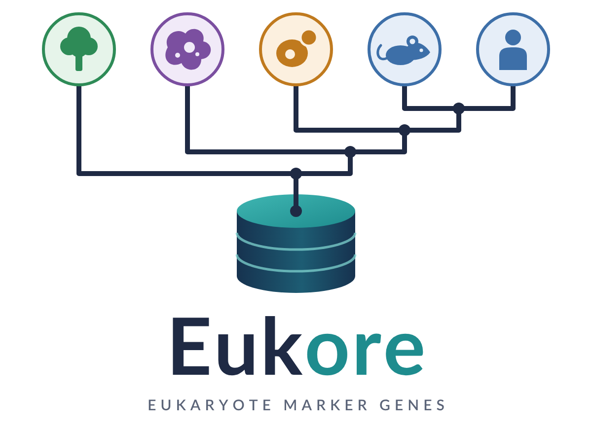
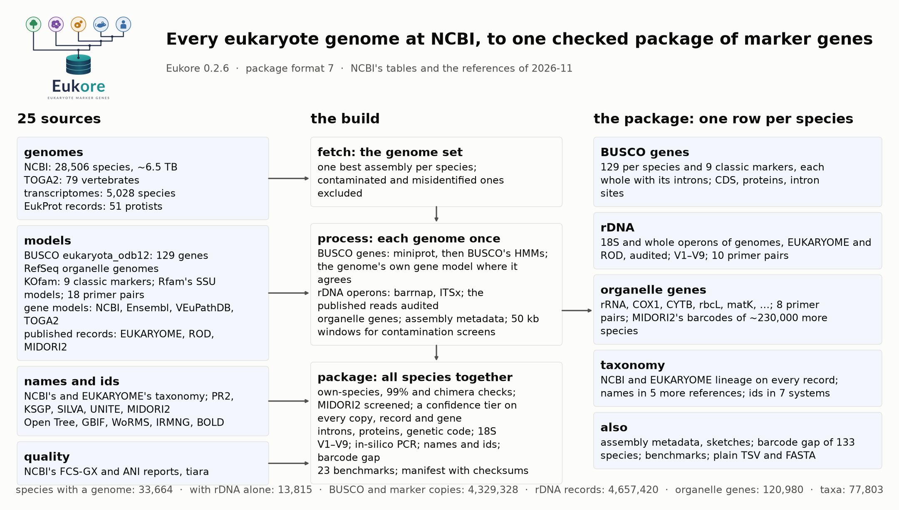
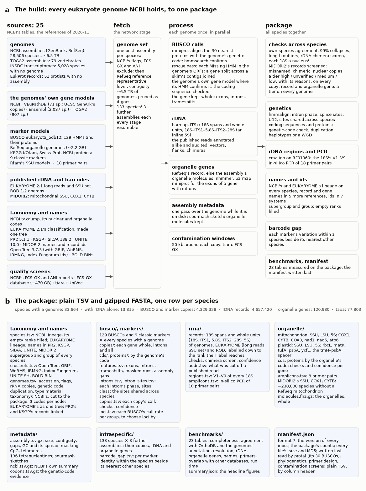
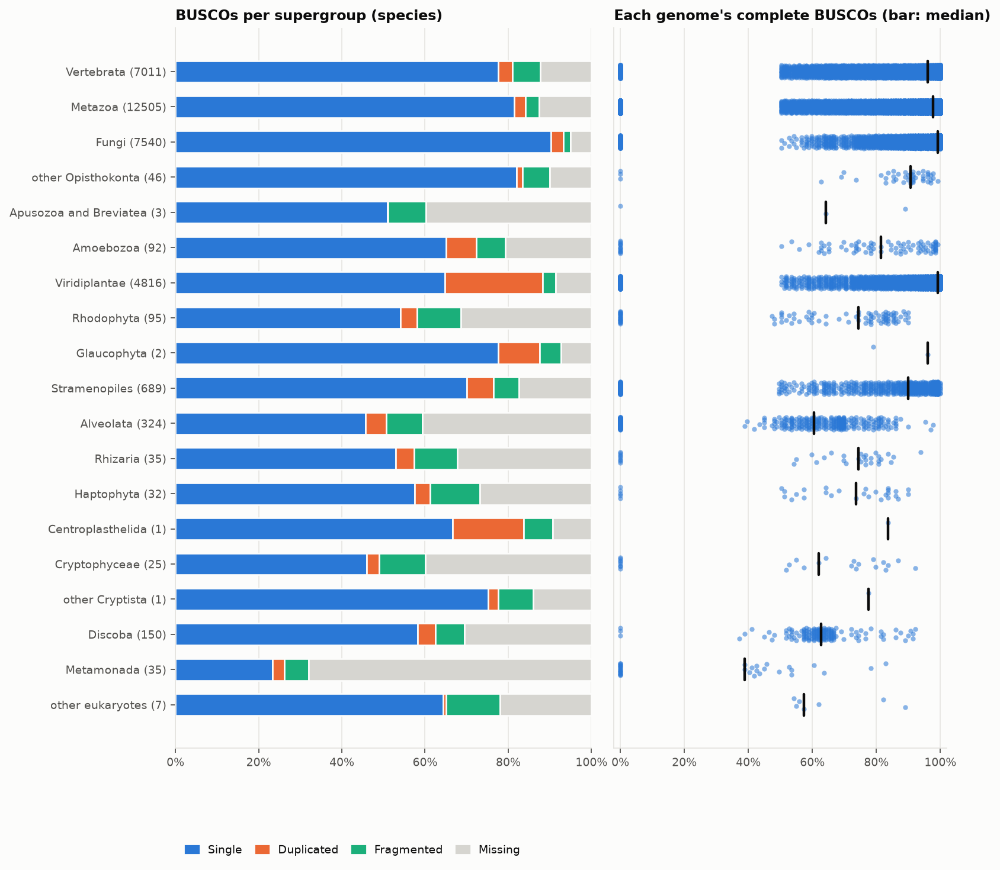
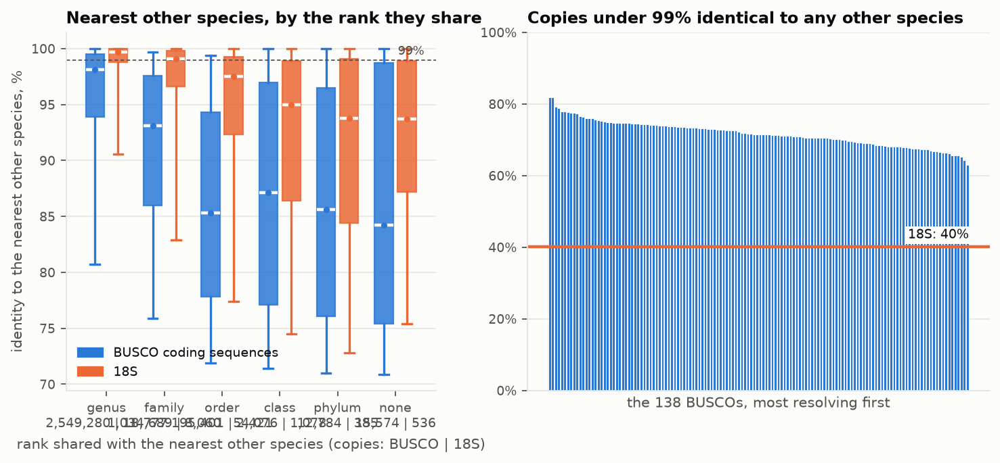

<p align="center">
  <picture>
    <source media="(prefers-color-scheme: dark)" srcset="docs/logo/eukore_logo_dark.png">
    
  </picture>
</p>

<p align="center">
  <b>A checked, complete reference of eukaryote marker genes, built from every eukaryote genome NCBI holds.</b><br>
  BUSCO genes with all their introns, their CDS and proteins · nine classic phylogenetic markers · whole rDNA operons
  and EUKARYOME's 18S, audited · 15 organelle barcode genes, with MIDORI2's screened COX1, CYTB and 12S · in-silico
  PCR of 18 barcode primer pairs · introns, genetic codes, duplication · NCBI's and EUKARYOME's taxonomy on every
  record, five more references' lineages and GBIF, Open Tree, WoRMS, UNITE, BOLD ids · a barcode gap · assembly metadata
</p>

<p align="center">
  <a href="#what-is-in-eukore">Contents</a> ·
  <a href="#where-to-find-it">Find it</a> ·
  <a href="#get-eukore">Get it</a> ·
  <a href="#use-a-package">Use it</a> ·
  <a href="#build-eukore">Build it</a> ·
  <a href="#benchmarks">Benchmarks</a> ·
  <a href="#documentation">Docs</a>
</p>

---

Eukore is two things:
- **a database**: for each eukaryote species with a genome at NCBI, its genes of BUSCO's 129 near-universal
  eukaryote orthologs and of nine classic markers, its rDNA operons and its organelle genes; beside them the published
  18S and operon reads of EUKARYOME and ROD and, for species without a genome, the mitochondrial barcode genes of
  RefSeq and MIDORI2. Each sequence is complete, carries its NCBI and its EUKARYOME lineage, is checked across
  species and given a confidence tier;
- **the software that builds it** (this repository): from NCBI's assemblies to a versioned, self-describing package,
  resumable on a cluster, with benchmarks measured on every build.

It is made for tools that detect and profile eukaryotes in metagenomes (protal reads it as its only source of
eukaryote marker genes, rRNA and names), and for anyone needing clean eukaryote marker genes: phylogenetics, primer
design, barcoding, contamination screens. Eukore's version is 0.2.6 (package format 7); it was named EUKDB until
2026-11-06.

<p align="center">
  
</p>

## What Eukore holds, and what it leaves out

**Capabilities.** One package gives a user, per species: nuclear protein-coding markers that tell congeners apart
(129 BUSCOs, 9 classic markers; gene, CDS and protein), the rRNA that amplicon studies use (18S with V1-V9, ITS,
28S), the organelle barcodes (COI, CYTB, 12S, 16S, rbcL, matK, ...), which primer pairs amplify it, its names in
seven taxonomies, and how far each sequence can be trusted.

**Taken in** (Eukore 0.2.6, format 7):
- **Genomes**: one assembly per NCBI species of GenBank's six eukaryote divisions (fungi, protists, plants,
  invertebrates, vertebrates), the best by NCBI's flags, its FCS-GX and ANI reports, RefSeq status, level and
  contiguity; TOGA2's vertebrate assemblies NCBI lacks; for a species without a genome, its INSDC transcriptome (TSA,
  10 Mb or more) or EukProt's records. The build of 2026-11-17 (Eukore 0.2.7) ran 33,460 species: 28,736 NCBI
  assemblies, 4,606 transcriptomes, 67 TOGA2 assemblies, 51 EukProt records.
- **Nuclear genes**: every BUSCO of eukaryota_odb12 and Eukore's nine own loci (RPB1, RPB2, EF-2, EF-1α, β-tubulin,
  actin, HSP90, GAPDH, H3), called by Eukore; a genome's own annotation (NCBI, VEuPathDB, Ensembl, TOGA2) gives the
  gene model where the HMM confirms it.
- **rRNA**: every genome's 18S and rDNA units (a transcriptome's too; an 18S from the species' next assembly where
  its genome holds none); as published records EUKARYOME 2.1's long reads and SSU set and ROD 1.2's operons, labelled
  down to the rank their label reaches.
- **Organelle genes**: of every species with a RefSeq organelle genome (with or without a nuclear genome), else of
  its assembly's organelle molecules; EUKARYOME's mitochondrial, plastid and nucleomorph SSU; and, one record a
  species without a RefSeq mitochondrial genome, MIDORI2's mitochondrial SSU (12S), COX1 and CYTB (COX1 of 213,812
  species, CYTB of 50,844, SSU of 56,311 on MIDORI2 GB273).
- **Names**: NCBI's taxonomy and EUKARYOME's as one tree, on every species, record and gene; each species' lineage
  in PR2, KSGP, SILVA, UNITE and MIDORI2 and its ids elsewhere.

**Left out:**
- an assembly NCBI flags (contaminated, unverified source organism, misassembled, chimeric, low quality), one FCS-GX
  finds mostly another organism's or that fails NCBI's ANI check, where the species has a better one; assemblies
  under 2 Mb or under 30% of the species' typical size; NCBI's placeholder species (`sp.`, uncultured) and crosses of two species ("A x B");
- the BUSCO copies of a genome that is a part of one, holds under half its clade's expected BUSCOs, or is the
  flagged only assembly of its species (the species stays, with its rRNA and organelle genes;
  `--keep_poor_genomes` keeps the copies, `low`);
- the sequences of PR2, KSGP and SILVA: their records are linked to Eukore's by accession and their lineages given,
  never taken; EUKARYOME's reads of compromised quality, its bacterial and archaeal SSU and pseudogenes;
- of a published read, what the audit finds is not its rRNA: vectors, adapters, barcodes, telomere repeats, DNA
  beside the gene, a chimera's foreign part;
- of MIDORI2, the records its screen calls another organism's gene, a chimera or another gene, those outside the
  gene's length, with over 0.5% ambiguous bases or without a reading frame (NUMTs), and its 16S (lrRNA) file;
- organelle rRNA among the nuclear records (a mitochondrial SSU is not an 18S); prokaryotes and viruses.

**Flagged, never silently dropped**: everything else. A fragment, a copy at a contig's end, a sequence shared with
another clade, a contaminant's copy or a bacterium's SSU stays in the package with its tier (`high`, `unverified`,
`medium`, `low`) and the reasons for it.

## What is in Eukore

| | per species | from | complete as |
|---|---|---|---|
| **BUSCO genes** | each of the 129 BUSCOs of eukaryota_odb12 called in its genome, with its exons and introns; their coding sequences and proteins | NCBI's best assembly of the species (else an INSDC transcriptome), called by Eukore (miniprot, then BUSCO's HMMs; a rescue pass for divergent genomes; a gene split across a skim's contigs joined) | the gene from first to last codon, introns and all, uncut and unmasked |
| **classic markers** | RPB1, RPB2, EF-2, EF-1α (TEF1), β-tubulin, actin, HSP90, GAPDH, histone H3: none is a BUSCO; Eukore's own loci, called as the BUSCOs are | KOfam's profiles of each ortholog, its paralogs' as decoys; Swiss-Prot's and NCBI's proteins | as the BUSCO genes (`markers/`) |
| **genetics** | each intron's phase, splice sites, U12 look and site on the gene's HMM; the genome's genetic code checked; its duplicated BUSCOs (haplotypes or a whole-genome duplication) | hmmalign on BUSCO's HMMs; vsearch | `busco/introns.tsv`, `intron_sites.tsv`, `genomes.tsv` |
| **rDNA operons** | its 18S spans and whole units (18S, ITS1, 5.8S, ITS2, 28S, an inline 5S); the 18S's V1-V9; in-silico PCR of 10 amplicon primer pairs | its assembly (barrnap, ITSx), else its next assembly's 18S; EUKARYOME's long reads and SSU set (labelled above species too; format 7) and ROD's operons, each audited as KSGP audits its records (vectors, flanks, chimeras); Infernal on Rfam's SSU models | from the 18S's start to the 28S's end |
| **organelle genes** | mitochondrial and plastid SSU, LSU, 5S rRNA; mitochondrial COX1, COX3, CYTB, nad1, nad5, atp6; plastid rbcL, matK, tufA, psbA, ycf1 and the trnH-psbA spacer; their proteins by the organelle's code, checks and confidence, barcode primers' PCR | RefSeq's organelle genomes (of every species with one), else its assembly's organelle molecules (kept whole too); EUKARYOME's organelle SSU; MIDORI2's screened mitochondrial SSU, COX1 and CYTB of species without a RefSeq mitochondrial genome | the gene with its introns (MIDORI2's: the record as published, on the gene's strand) |
| **assembly metadata** | its genome's size, contiguity, gaps, GC and its spread, soft-masking, CpG, duplicates, telomeres, organelle molecules, tetranucleotides, a sourmash sketch; NCBI's own summary | measured while the genome is on disk, before the build deletes it | in the package's `metadata/` |
| **taxonomy** | NCBI's lineage (and with its empty ranks filled), supergroup (Obazoa, TSAR, ...) and group; its complete EUKARYOME lineage in one EUKARYOME tree free of homonyms, as every record's and organelle gene's (format 7); its lineage in PR2, KSGP, SILVA, UNITE and MIDORI2; each rRNA record's PR2 and KSGP records (`taxonomy/links.tsv`); its Open Tree, GBIF, WoRMS, IRMNG, UNITE SH (and BOLD BIN) ids; its genome's type material | NCBI's taxdump, cut to the package; EUKARYOME 2.1's classification | tied to no GTDB release |
| **barcode gap** | for a panel of 133 well-sampled species, each marker's variation within the species beside its distance to the nearest other species | up to 3 further assemblies of each (other strains) | `intraspecific/` |
| **checks** | per copy and record: own-species agreement (the owner of a sequence two clades' genomes share told), 99% collapses, length outliers, contig ends, assembly gaps, coding sequences against the proteins confirmed, tiara's and FCS-GX's contamination screens, an rRNA chimera screen, each 18S a nucleus', the published reads' audit, MIDORI2's reference screen; a `high`/`unverified`/`medium`/`low` tier with its reasons; per genome a tier (`genome`, `draft`, `transcriptome`, `poor`, `partial`, `contaminated`) by its clade's expected BUSCOs | Eukore's checks across species | flagged, never silently dropped |
| **benchmarks** | completeness, agreement with OrthoDB's gene models, marker resolution, rRNA completeness, naming, primer coverage, the barcode gap, run time | measured by each build | in the package's `benchmarks/` |

A species is in the package by its genome (`species.tsv`'s `source`: an NCBI or TOGA2 assembly, `tsa` a
transcriptome, EukProt's records), by rRNA records alone, or by organelle genes alone (`organelle`). The first full
build (format 6) held 47,479 species, 33,664 of them with a genome; the build of 2026-11-17 (format 7: EUKARYOME's
published 18S, MIDORI2's genes) holds 328,262: 33,460 with a genome, 50,667 by rRNA records alone and 244,135 by
organelle genes alone, most of those a mitochondrial barcode gene.

A package is plain TSV and gzipped FASTA with a `manifest.json` of checksums; its format is
[docs/FORMAT.md](docs/FORMAT.md) (format 7). Every `.gz` file is BGZF (blocked gzip, since 2026-11-09): any gzip
reader reads it, `bgzip -d -@` decompresses it on many threads.

```
Eukore_2026.11/
├── manifest.json            versions, inputs, counts, every file's size and MD5 (written last)
├── species.tsv              one row per species: its source, supergroup, group, NCBI and six references' lineages
├── crossrefs.tsv            each species' ids: Open Tree, GBIF, WoRMS, IRMNG, UNITE SH, BOLD BIN
├── genomes.tsv              the species' genomes: accession, tier, quality flags, rRNA copies, genetic code, duplication
├── copy_numbers.tsv.gz      each genome's copies of every locus, rRNA gene and unit, organelle molecule and gene
├── reference_screen.tsv     MIDORI2's records the screen dropped, cut or left for review
├── taxonomy/                NCBI's taxonomy, cut to the package (nodes with nuclear and organelle codes, names);
│                            EUKARYOME's as one tree (eukaryome.tsv); PR2's and KSGP's records linked (links.tsv)
├── busco/                   loci.tsv (call rates per BUSCO), copies.tsv (calls, checks, confidence),
│                            features.tsv, introns.tsv, intron_sites.tsv, copies/, cds/, proteins/<locus>.*.gz
├── markers/                 Eukore's nine own loci (RPB1, RPB2, EF-2, TEF1, ...), as busco/
├── rrna/                    records.tsv, records.fna.gz, audit.tsv (what was cut off the published reads, and why),
│                            regions.tsv (18S V1-V9), amplicons.tsv (in-silico PCR)
├── organelle/               genes.tsv, genes.fna.gz, cds.fna.gz, proteins.faa.gz, amplicons.tsv, molecules.fna.gz
├── intraspecific/           the panel's further assemblies' copies, barcode_gap.tsv
├── metadata/                assembly.tsv.gz, tetranucleotides.tsv.gz, sketches.zip, ncbi.tsv.gz, codons.tsv.gz
└── benchmarks/              the build's measures of the package
```

## Where to find it

What you may want, where it is in a package, and where it is described. The file-by-file description is
[docs/FORMAT.md](docs/FORMAT.md) ([every file](docs/FORMAT.md#every-file)); how each is made,
[docs/methods.md](docs/methods.md).

| you want | file | its columns / records | described in |
|---|---|---|---|
| **Marker genes** | | | |
| a BUSCO's copies, introns and all | `busco/copies/<locus>.fna.gz` | `>accession` | [FORMAT: busco/](docs/FORMAT.md#busco) |
| their coding sequences, proteins | `busco/cds/<locus>.fna.gz`, `busco/proteins/<locus>.faa.gz` | `>accession` | [FORMAT: busco/](docs/FORMAT.md#busco) |
| RPB1, RPB2, EF-2, EF-1α (TEF1), β-tubulin, actin, HSP90, GAPDH, histone H3: the classic phylogenetic markers BUSCO cannot hold | `markers/copies/`, `cds/`, `proteins/<locus>.*.gz`; `markers/copies.tsv` | as `busco/`'s | [FORMAT: markers/](docs/FORMAT.md#markers-format-5), [loci.md](docs/loci.md) |
| which BUSCOs a clade holds (to choose loci) | `busco/loci.tsv` | `call_rate`, `call_<group>` | [loci.md](docs/loci.md) |
| a copy's quality | `busco/copies.tsv` | `confidence`, `flags`, `own_species`, `same_as` | [FORMAT: busco/](docs/FORMAT.md#busco) |
| 18S, ITS, 28S of a species | `rrna/records.fna.gz`, `rrna/records.tsv` | `regions` (18S, ITS1, 5.8S, ITS2, 28S, 5S) | [FORMAT: rrna/](docs/FORMAT.md#rrna) |
| an 18S variable region (V4, V9, ...) | `rrna/regions.tsv` | `record`, `region`, `start`, `end`, `complete` | [FORMAT: rrna/](docs/FORMAT.md#rrna), [methods](docs/methods.md#18s-variable-regions-and-in-silico-pcr-since-2026-11-07) |
| COI, CYTB, 12S, 16S, nad1, nad5, atp6, COX3; rbcL, matK, psbA, ycf1, tufA, trnH-psbA | `organelle/genes.fna.gz`, `cds.fna.gz`, `proteins.faa.gz`; `organelle/genes.tsv` | `gene`, `name`, `confidence`, `flags` | [FORMAT: organelle/](docs/FORMAT.md#organelle) |
| **Primers and amplicons** | | | |
| whether a primer pair amplifies a species (V4, V9, ITS, D1-D2, COI, rbcL, matK, psbA-trnH, 12S, 16S) | `rrna/amplicons.tsv`, `organelle/amplicons.tsv` | `pair`, `amplifies`, mismatches, `length` | [FORMAT: rrna/](docs/FORMAT.md#rrna), primers: `data/primers.tsv` |
| a pair's coverage per group | `benchmarks/primers.tsv` | `pair`, `supergroup`, `share` | [benchmarks.md](docs/benchmarks.md) |
| **Genetics** | | | |
| introns: phase, splice sites, U12, conserved sites | `busco/introns.tsv`, `busco/intron_sites.tsv` | `phase`, `class`, `u12`, `site`, `share_<group>` | [FORMAT: busco/](docs/FORMAT.md#busco) |
| a genome's genetic code and its check | `genomes.tsv`; `metadata/codons.tsv.gz` | `gencode`, `gencode_check`, `best_table` | [FORMAT: genomes.tsv](docs/FORMAT.md#genomestsv) |
| organelle genetic codes | `taxonomy/nodes.tsv` | `mgcode`, `pgcode` | [FORMAT: taxonomy/](docs/FORMAT.md#taxonomy) |
| haplotypes in an assembly, a whole-genome duplication | `genomes.tsv`; `busco/copies.tsv` | `duplication`, `dup_identity_median`; `dup_identity` | [FORMAT: genomes.tsv](docs/FORMAT.md#genomestsv) |
| a genome's copy numbers: each locus, rRNA gene and unit, organelle molecule and gene (by reads where measured) | `copy_numbers.tsv.gz` | `set`, `element`, `copies`, `partial`, `basis` | [FORMAT: copy_numbers.tsv.gz](docs/FORMAT.md#copy_numberstsvgz-format-5) |
| how far a marker varies within a species | `intraspecific/barcode_gap.tsv` | `intra_min`, `inter_max`, `gap`, `resolved` | [FORMAT: intraspecific/](docs/FORMAT.md#intraspecific-format-5) |
| **Taxonomy and names** | | | |
| a species' supergroup (Obazoa, TSAR, ...) and group | `species.tsv` | `supergroup`, `group` | [FORMAT: species.tsv](docs/FORMAT.md#speciestsv), `data/supergroups.tsv` |
| its NCBI lineage, empty ranks filled | `species.tsv` | `ncbi_lineage`, `ncbi_lineage_filled` | [FORMAT: species.tsv](docs/FORMAT.md#speciestsv) |
| its name in PR2, EUKARYOME, KSGP, SILVA, UNITE, MIDORI2 | `species.tsv` | `pr2`, `eukaryome`, `ksgp`, `silva`, `unite`, `midori2` (and `_match`) | [FORMAT: species.tsv](docs/FORMAT.md#speciestsv) |
| its Open Tree, GBIF, WoRMS, IRMNG, Index Fungorum id; UNITE SH; BOLD BIN | `crossrefs.tsv` | `reference`, `id` | [FORMAT: crossrefs.tsv](docs/FORMAT.md#crossrefstsv-format-5) |
| whether its genome is from type material | `species.tsv`, `genomes.tsv` | `type_material` | [FORMAT: genomes.tsv](docs/FORMAT.md#genomestsv) |
| species known from a transcriptome alone | `species.tsv` | `source` = `tsa` | [methods](docs/methods.md#the-barcode-gap-and-transcriptomes-since-2026-11-07) |
| its EUKARYOME lineage, complete, and a record's (labelled above species too) | `species.tsv`, `rrna/records.tsv`, `organelle/genes.tsv`; `taxonomy/eukaryome.tsv` | `eukaryome`, `eukaryome_lineage`, `eukaryome_match`, `rank` | [FORMAT: taxonomy/](docs/FORMAT.md#taxonomy) |
| species known from organelle genes alone (a RefSeq organelle genome) | `species.tsv` | `source` = `organelle` | [FORMAT: organelle/](docs/FORMAT.md#organelle) |
| **Genomes** | | | |
| a genome's size, contiguity, GC, masking, telomeres, sketch | `metadata/assembly.tsv.gz`, `metadata/sketches.zip` | | [FORMAT: metadata/](docs/FORMAT.md#metadata) |

## Get Eukore

**Prebuilt releases**: none is published yet. Two full builds of NCBI's genomes of 2026-11 were made and evaluated:
Eukore 0.2.4, format 6 (2026-11-14) and Eukore 0.2.7, format 7 (2026-11-17, the one the numbers here are of); the
fixes each led to are in this repository, and the release will be built from them. Until it is published, build it yourself (below): a trial of
seven clades took about an hour on 6 cores, the full reference needs a cluster.

A release is published on Eukore's website (`website/`, PHP; the [website's README](website/README.md)): its
statistics (species by genome source and supergroup, the taxonomy as a tree, the marker categories) and its
downloads: the complete package, the marker genes with or without introns, the rRNA and organelle markers, the
sourmash sketches and each metadata table, all BGZF. The package stage writes both into `OUT/release/` from the
package it built (`--stage release` again, `--no_release` none).

## Use a package

The tables are plain TSV, read by any tool. With Eukore's own reader:

```python
from eukore import package, ncbi
pkg = "Eukore_2026.11"
print(package.check(pkg, deep=True) or "whole")           # every file against the manifest's size and MD5

species = package.read_table(pkg, "species.tsv")           # taxid, supergroup, group, lineages in NCBI, PR2, ...
loci = package.read_table(pkg, "busco/loci.tsv")           # each BUSCO's call rates, to choose loci by
copies = package.read_table(pkg, "busco/copies.tsv")       # each copy's call, checks and confidence
seqs = package.read_copies(pkg, "10248812at2759")          # {accession: the copy, introns and all}
cds = package.read_copies(pkg, "10248812at2759", "cds")    # {accession: its coding sequence}; "proteins" too
introns = package.read_table(pkg, "busco/introns.tsv")     # each intron's phase, class, U12 look, HMM site
v4 = [r for r in package.read_table(pkg, "rrna/regions.tsv") if r["region"] == "V4"]  # where each 18S's V4 lies
pcr = package.read_table(pkg, "organelle/amplicons.tsv")   # which records each barcode primer pair amplifies
ids = package.read_table(pkg, "crossrefs.tsv")             # GBIF, Open Tree, WoRMS, UNITE SH, BOLD BIN ids
tax = ncbi.Ncbi(f"{pkg}/taxonomy")                         # the NCBI taxonomy the package was built on
code = tax.code_of(5911, "mito")                           # a taxon's nuclear, "mito" or "plastid" genetic code
```

A typical use keeps the `high` and `medium` copies of the BUSCOs it chooses (by `busco/loci.tsv`'s call rates in the
groups it cares about, `call_<group>`; [docs/loci.md](docs/loci.md)) and masks, cuts or renames them to its own needs. protal's
database build does this with its own reader (`download_ref_data.py --eukdb Eukore_2026.11`): the 30 BUSCOs of its
euk30, KSGP names, copies fitted into 16 kb. A reader other than Eukore's should read the tables by their header, so
that new columns do not break it.

## Build Eukore

Eukore runs on Linux (or WSL) with a conda-style package manager; its tools are bioconda's.

```bash
git clone https://github.com/hildebra/Eukore.git && cd Eukore
micromamba create -f envs/eukore.yaml && micromamba activate eukore
python3 -m unittest discover -s tests -t tests            # ~140 tests with stand-in tools, seconds
```

A **trial** builds a few clades on one machine (here *Saccharomyces*, taxid 4930); its manifest marks it partial:

```bash
python3 eukore_build.py --build_dir work --out out --groups fungi --species 4930 -t 8
```

The **full reference** is built in three stages, the first where the network is, the rest on compute nodes:

```bash
python3 eukore_build.py --build_dir WORK --out OUT --stage fetch             # sources and genomes (~6.5 TB, pruned as it goes)
python3 eukore_build.py --build_dir WORK --out OUT --stage process -t 64 \
    [--memory_gb 200] [--local_tmp /local/disk]                              # each genome's genes and rRNA
python3 eukore_build.py --build_dir WORK --out OUT --stage package -t 64 \
    [--fcs_gx_db /dev/shm/gxdb/all] [--tiara .../bin/tiara]                  # checks, rRNA, labels, package, benchmarks,
                                                                             # the release (OUT/release/)
```

Every stage is resumable: a rerun does only what is not done. Optional tools: tiara (the windows around each copy
classified) and NCBI's FCS-GX with its ~470 GB database (contamination screen). Installation, options, resources and
outputs are in [docs/building.md](docs/building.md).

### How it works

1. **Genome set.** Per NCBI species, its best assembly: NCBI's contamination, misassembly and ANI flags excluded,
   FCS-GX's contaminated assemblies demoted, then RefSeq reference, representative, assembly level, contiguity; a
   TOGA2 assembly or a transcriptome where NCBI has no genome.
2. **BUSCO and marker calls.** miniprot aligns the 30 proteins of BUSCO's dataset nearest to the genome (and its
   ancestral variants) with the genome's genetic code; hmmsearch confirms each region against all BUSCO HMMs at
   BUSCO's cutoffs; the best copy is kept whole, its exons and introns annotated. A locus still missing is searched
   by its HMM in the genome's ORFs (the rescue pass); a gene cut by a skim's contigs is joined; the genome's own
   annotation gives the model where the HMM confirms it; the coding sequence shipped is checked against the protein
   confirmed.
3. **rRNA.** barrnap finds each genome's rRNA genes and ITSx the ITS borders (with the lineage's profiles); whole
   units are kept uncut. EUKARYOME's long reads and SSU set and ROD's operons are labelled by NCBI taxid and by
   EUKARYOME's tree, annotated alike, and audited (ends, flanks, vectors, chimeras).
4. **Organelle genes** (rRNA and 12 protein-coding or spacer genes) from RefSeq's organelle genomes, else from the
   assembly's organelle molecules (nhmmer, miniprot, barrnap); MIDORI2's SSU, COX1 and CYTB, screened for misnamed
   and chimeric records, of the species RefSeq does not cover.
5. **Assembly metadata.** One pass over each genome while it is on disk (`eukore/metadata.py`), and a sourmash
   sketch: what a user needs of the genome once the build has deleted it.
6. **Checks across species.** Each copy against the same gene of every other species (own-species agreement,
   identical copies, length outliers), an rRNA part screen for chimeras, each 18S against Rfam's eukaryote and
   prokaryote SSU models, tiara and FCS-GX on each copy's 50 kb window; each copy and record gets a confidence tier
   with its reasons, each genome a tier by its clade's expected BUSCOs.
7. **Package and benchmarks**, the manifest written last; then the release (the website's data and downloads).

<p align="center">
  
</p>

The figure (`docs/figures/overview.py`) describes Eukore 0.2.7 (format 7); its genome numbers and the counts that
head panel b (`--package`) are those of the build of 2026-11-17 (Eukore_2026.11, format 7), the references' those of
2026-11. The figure at the top of this page is its short form (`--slide`, 16:9, for a presentation).

Details, and what was checked on real genomes, are in [docs/methods.md](docs/methods.md).

## Benchmarks

Each build measures its package ([docs/benchmarks.md](docs/benchmarks.md)): BUSCO completeness per genome and
supergroup; its calls against OrthoDB's own gene models of the same species; how far each marker tells species apart
(the identity of each copy's nearest other species, by the rank they share); rRNA operon completeness; naming in
PR2, EUKARYOME and KSGP; run time. The comparisons with other references (EukDetect2, MetaPhlAn 4, PR2), the read
benchmark and every figure, Figure 1 among them, run on a finished package from [benchmarks/](benchmarks/README.md);
so does (since 2026-11-12) what describes the package as a resource: its breadth at every rank, the markers one species
links, Eukore beside the other databases as collections of records, the checks' shares, the tree of the BUSCO proteins
against NCBI's taxonomy, the identity that parts taxa, and the changes from one release to the next.

On the build of 2026-11-17 (Eukore_2026.11: Eukore 0.2.7, format 7; not a release: built without tiara, VEuPathDB's
annotations and KSGP 5.2, and before the fixes its evaluation led to):

| benchmark | figure |
|---|---|
| species; with a genome; with rRNA records alone; with organelle genes alone | 328,262; 33,460; 50,667; 244,135 |
| species with an rRNA record; a whole operon; an organelle gene | 79,581; 31,294; 297,379 |
| median complete BUSCOs per genome | 98.4% (77.6% of genomes at 90% or more) |
| BUSCOs OrthoDB has a gene model of, called | 98.8% of 88,053 (837 species) |
| of those called, OrthoDB's gene model (5-mers ≥ 90% both ways) | 91.9% |
| the same, called without the species' own proteins | 99.0% called, 82.8% of them OrthoDB's gene model |
| calls laid on their genome's annotation (8,378 genomes) | introns exact 92.3%; coding bases' recall 94.5%, precision 96.7% |
| BUSCO and marker copies; `high`, `unverified`, `medium`, `low` | 4,114,253; 61.6%, 4.4%, 33.9%, 0.1% |
| BUSCO copies under 99% identical to their nearest congener | 62.4% of 2,440,007 |
| 18S copies under 99% identical to their nearest congener | 30.6% of 45,999 |
| COX1 copies under 99% identical to their nearest congener | 84.6% of 171,050 |
| rRNA records; operons with a whole 28S | 5,102,572; 95.1% of 2,645,832 |
| genome run (BUSCOs, rRNA), median | 1.1 min, 3 min per Gb of genome |

<p align="center">
  <br>
  
</p>

Among congeners the BUSCO genes tell species apart where the 18S cannot (62% of copies under 99% to their nearest
congener, against 27% of 18S). Completeness is uneven: animals, plants and fungi have a median of 95-99% of the
129 BUSCOs, Alveolata, Discoba and Metamonada 37-57%, where many of these genes are lost or too diverged for the
dataset's proteins to find; genomes are therefore judged by their clade's expected BUSCOs (`genomes.tsv`'s `tier`).
The two figures are that build's. All figures and what they show: [docs/benchmarks.md](docs/benchmarks.md).

## Documentation

| | |
|---|---|
| [docs/building.md](docs/building.md) | install, a trial, a full build on a cluster, options, resources, resuming, outputs |
| [docs/methods.md](docs/methods.md) | how the genomes are chosen and the genes, operons and organelle genes made and checked; since 0.2 the copies' genetics (proteins, introns, code check, duplication), the organelle genes' models and checks, the 18S regions and primers, the taxonomy and references, the barcode gap and transcriptomes |
| [docs/FORMAT.md](docs/FORMAT.md) | the package format, file by file and column by column ([every file](docs/FORMAT.md#every-file) at a glance; [what changed](docs/FORMAT.md#changes)) |
| [docs/benchmarks.md](docs/benchmarks.md) | what each of the build's benchmarks measures, how to run them |
| [benchmarks/README.md](benchmarks/README.md) | on a finished package: what it holds as a resource (breadth at every rank, linked markers, named lists), Eukore beside the other databases, the records' quality and the tree, the identity that parts taxa, the release among releases, the read benchmark and every figure |
| [docs/use_cases.md](docs/use_cases.md) | four short uses of a package: loci for a clade, a primer pair, a tree, a mapping reference |
| [docs/loci.md](docs/loci.md) | choosing BUSCOs for a use; the BUSCOs with prokaryote homologues; the classic markers (none is a BUSCO) |
| [docs/read_depth.md](docs/read_depth.md) | rDNA and organelle copies by read depth (`tools/rdna_depth.py`, a prototype) |

## Repository layout

| path | |
|---|---|
| `eukore_build.py` | the build (stages fetch, process, package) |
| `eukore/` | the package: `genomes.py` (genome set, one genome's run), `odb.py`, `loci.py` (BUSCO calls), `rrna.py`, `screen.py` (rRNA and its chimera screen), `organelle.py`, `qc.py` (checks across species), `quality.py` (NCBI's FCS-GX and ANI reports), `labels.py` (PR2, EUKARYOME, KSGP, SILVA, UNITE, MIDORI2; crossrefs), `refscreen.py` (the reference screen: MIDORI2's misnamed and chimeric records), `audit.py` and `chimeras.py` (the published reads' audit: ends, flanks, vectors, chimeras), `eukaryome.py` (EUKARYOME's taxonomy as one tree), `links.py` (PR2's and KSGP's records linked), `tiers.py` (each clade's expected BUSCOs, the genomes' tiers), `annotation.py` (the genomes' own gene models), `groups.py` (supergroups, groups), `gencode.py` (NCBI's genetic codes), `align.py` (hmmalign), `introns.py`, `codecheck.py` (genetic code check), `regions.py` (18S V1-V9, cmalign), `primers.py` (in-silico PCR), `intraspecific.py` (barcode gap), `markers.py` (Eukore's marker set: KOfam, Swiss-Prot, NCBI), `package.py` (write, read, check), `benchmarks.py`, `release.py` (the website's data and the downloads), `util.py` (BGZF, downloads, progress) |
| `data/` | the model species, curated rDNA units, the records of species without an assembly; since 0.2 `supergroups.tsv` (supergroups and groups), `primers.tsv` and `primer_pairs.tsv` (the in-silico PCR), `primer_references.fna` (their test records), `rrna_regions.tsv` (the 18S V-regions on yeast), `intraspecific_panel.tsv` (the barcode gap's species), `classic_markers.*`, `markers.tsv` (Eukore's marker loci: their KOfam targets and decoys) |
| `envs/` | the micromamba environments (`eukore.yaml`; `tiara.yaml`, tiara needing an older Python) |
| `tools/` | choosing loci: `rank_loci.py`, `eukaryote_panel.py`, `prokaryote_panel.py`, `prokaryote_separation.py`; `classic_markers.py` (classic markers among the BUSCOs), `primer_references.py` (the primers' test records), `organelle_models.py` (nhmmer against miniprot on RefSeq's exons), `validate_markers.py` (the marker loci against each species' own reference protein, held out), `screen_reference.py` (the reference screen on MIDORI2's files: KSGP's lists and the screened FASTA), (`eukore/run_report.py`, how a run went, is in every build's evaluation bundle: [building.md](docs/building.md#the-evaluation-bundle)) |
| `tests/` | unit and end-to-end tests with stand-in tools |
| `docs/` | documentation, the format, a trial's benchmark figures, the logo |
| `benchmarks/` | (since 2026-11-12) what a paper needs and the build does not: the comparisons with EukDetect2, MetaPhlAn 4 and PR2, the read benchmark, every figure (`eukore-bench-prep.sh`, `eukore-benchmark.sh`, `eukore-figures.sh`; `eukore_bench/`), in their own environment |
| `website/` | Eukore's website (PHP): home, statistics, downloads, tutorial, acknowledgements; it reads a build's `OUT/release/` |
| `LICENSE` | GPL-2.0 |

## Status and limitations

**Where it stands** (2026-11-17):
- **Version 0.2.7, package format 7.** Two full builds exist: Eukore 0.2.4, format 6 (2026-11-14: 33,664 genomes,
  none failed) and Eukore 0.2.7, format 7 (2026-11-17: 33,460 genomes, none failed, 6 not fetched; 328,262
  species; its final job 9 h 31 m). The second ran what came after the first:
  - *the first build's fixes* (2026-11-14): genome tiers by each clade's expected BUSCOs, a poor, partial or
    contaminated genome's copies left out; Eukore's own protist proteins as queries; a copy split across a skim's
    contigs joined; an 18S from a species' next assembly, transcriptomes' rRNA, a 10 Mb floor for transcriptomes;
    organelle genes on candidate contigs; MIDORI2 and UCSC GenArk's gene models fetched by the build;
  - *format 7* (2026-11-14): EUKARYOME's records the only published 18S (its SSU set beside its long reads), each
    audited at build time as KSGP 4.1-4.5 audit theirs (`rrna/audit.tsv`); PR2's and KSGP's records linked, not
    taken (`taxonomy/links.tsv`); EUKARYOME's reads labelled above species; the organelle genes of every species
    with a RefSeq organelle genome; every species', record's and gene's EUKARYOME lineage in one tree
    (`taxonomy/eukaryome.tsv`);
  - *2026-11-15*: MIDORI2's COX1 and CYTB beside its mitochondrial SSU, screened and filtered by protal's rules;
    EUKARYOME's tree free of homonyms (a genus name of another phylum is not a species' genus; an NCBI clade
    EUKARYOME names otherwise takes EUKARYOME's taxon). The organelle step was the 2026-11-17 build's longest (6 h 01 m):
    its search across species aligned long genes whole.
  Not yet run on a full build: the changes of 2026-11-17 (a copy's first 5,000 bases compared across species; the
  helpers at the search with the fewest parts left; the rRNA part screen's four parts at once); tiara, VEuPathDB's
  annotations (no key) and KSGP 5.2 were in neither build.
- **Changes by format**: [docs/FORMAT.md](docs/FORMAT.md#changes). Format 6 (2026-11-09) brought the four confidence
  tiers, checked coding sequences, a Duplicated locus' copy chosen by lineage, the owner of a shared sequence, the
  18S checked to be a nucleus'.

**Limitations:**
- Protist lineages are thin: 42 of the 129 BUSCOs are called in under 20% of Discoba's genomes, and a gene model
  made without a near relative's proteins is approximate (held out, 83% of calls are OrthoDB's gene model overall,
  under 50% in Alveolata and Amoebozoa).
- A third of the BUSCO copies are `medium` (a fragment, a contig's end, a duplicate, ...) and 4% `unverified` (no
  relative near enough to check them by, a third of them of a species alone in its family).
- MIDORI2's records are one gene of one specimen under GenBank's name: screened across orders, not within one.
- FCS-GX has been run with stand-ins only (its database is ~470 GB).
- The organelle genes have checks across species and a confidence tier since 0.2, measured on a trial without RefSeq's organelle release (assembly molecules alone). In assemblies, a protein-coding gene with introns takes miniprot's exons (median F1 0.96-0.99 against RefSeq's, against nhmmer's joined hits' 0.27-0.60), one without nhmmer's single hit ([methods.md](docs/methods.md)); a few splice sites stay off by some bases.
- The genetic code check judges only the stop codons and CTG, where seen often enough at conserved positions (CTG-clade yeasts avoid CTG: not judged); a transcriptome's BUSCO copies (TSA, a species without a genome) have no introns and are at most `medium`.
- The 28S's D domains are not given (no published coordinates on one reference found); none of the classic markers RPB1, RPB2, TEF1, TUB2 is a BUSCO ([docs/loci.md](docs/loci.md)): they are Eukore's own loci (`markers/`), validated on the trial's genomes against their species' own proteins only; a family marker's copy (actin, β-tubulin, HSP90, GAPDH, H3) is its best member, not one chosen ortholog.
- protal reads `call_<supergroup>` of format 4: format 5 has `call_<group>` (SAR split into Stramenopiles, Alveolata, Rhizaria, Telonemia).
- `genomes.tsv`'s rDNA copy numbers are those of the assembly, a lower bound (arrays collapse);
  `tools/rdna_depth.py` measures a genome's own from its reads, a prototype run on 10 genomes
  ([docs/read_depth.md](docs/read_depth.md)). The intergenic spacer, 5S arrays away from the unit and the 28S's
  introns are not taken.
- Four BUSCOs have prokaryote homologues (archaeal ribosome biogenesis, cytochrome c oxidase assembly; see
  [docs/loci.md](docs/loci.md)); whether to replace them in protal's euk30 is open.

## Sources and credits

Eukore is built from public data, each under its own terms; check them before redistributing a package:
- **sequences**: NCBI's GenBank and RefSeq assemblies and RefSeq's organelle genomes; INSDC's transcriptome
  assemblies (via ENA); TOGA2's vertebrate assemblies; EUKARYOME 2.1 (long reads, SSU set); the rRNA Operon Database
  (ROD) 1.2; MIDORI2 (SSU, COX1, CYTB); the records of species without an assembly from EukDetect2 (CC BY 4.0; Shih,
  Zhao, Pollard & Lind 2026), of EukProt;
- **models and proteins**: BUSCO's eukaryota_odb12 (OrthoDB 12.1); KEGG's KOfam profiles, Swiss-Prot's and NCBI's
  proteins (the marker loci); Rfam's SSU models; gene models of NCBI, VEuPathDB, Ensembl, TOGA2 and UCSC GenArk;
  NCBI's UniVec;
- **names and screens**: NCBI's taxonomy, FCS-GX and ANI reports; EUKARYOME's classification; PR2 5.1.1, KSGP, SILVA
  138.2 and UNITE 10.0 (names and record ids alone, no sequence); Open Tree of Life, GBIF, WoRMS, IRMNG, BOLD.

It runs miniprot, HMMER, barrnap, ITSx, vsearch, Infernal, minimap2 and sourmash, and optionally tiara and NCBI
FCS-GX: please cite them with Eukore.

Eukore started inside protal's repository (`EUKDBbuild/`, 2026-11-05) and keeps that history. Questions and bug
reports: [GitHub issues](https://github.com/hildebra/Eukore/issues).

## License

Eukore's code is licensed under the GNU General Public License, version 2.0 ([LICENSE](LICENSE)). The data a package
holds keep their sources' terms (above).
