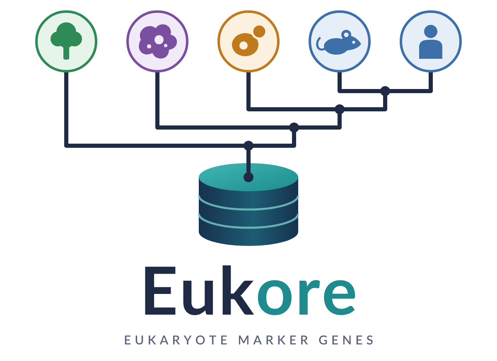
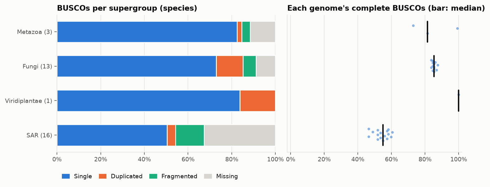
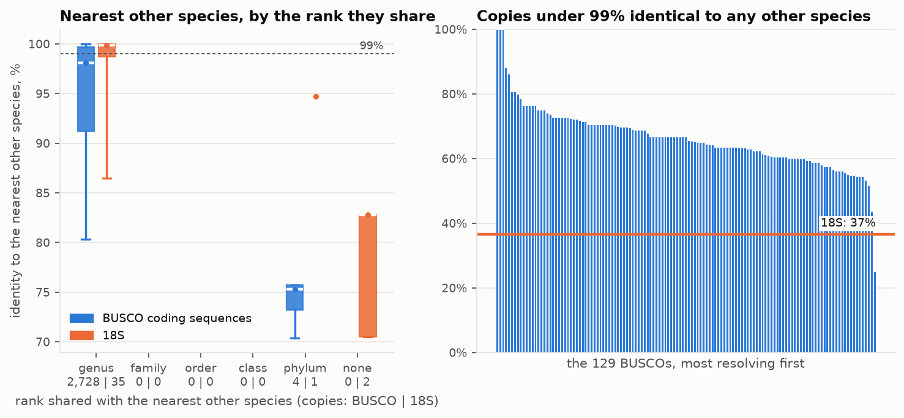

<p align="center">
  <picture>
    <source media="(prefers-color-scheme: dark)" srcset="docs/logo/eukore_logo_dark.png">
    
  </picture>
</p>

<p align="center">
  <b>A checked, complete reference of eukaryote marker genes, built from every eukaryote genome NCBI holds.</b><br>
  BUSCO genes with all their introns, their CDS and proteins · whole rDNA operons with 18S V-regions · 15 organelle
  barcode genes · in-silico PCR of 18 barcode primer pairs · introns, genetic codes, duplication · six references'
  lineages and GBIF, Open Tree, WoRMS, UNITE, BOLD ids · a barcode gap · assembly metadata
</p>

<p align="center">
  <a href="#what-is-in-eukore">Contents</a> ·
  <a href="#where-to-find-it">Find it</a> ·
  <a href="#get-eukore">Get it</a> ·
  <a href="#use-a-package">Use it</a> ·
  <a href="#build-eukore">Build it</a> ·
  <a href="#benchmarks">Benchmarks</a> ·
  <a href="#documentation">Docs</a>
</p>

---

Eukore is two things:
- **a database**: for each eukaryote species with a genome at NCBI, its genes of BUSCO's 129 near-universal
  eukaryote orthologs, its rDNA operons and its organelle rRNA, each sequence complete, labelled by NCBI's taxonomy,
  checked across species and given a confidence tier;
- **the software that builds it** (this repository): from NCBI's assemblies to a versioned, self-describing package,
  resumable on a cluster, with benchmarks measured on every build.

It is made for tools that detect and profile eukaryotes in metagenomes (protal reads it as its eukaryote reference),
and for anyone needing clean eukaryote marker genes: phylogenetics, primer design, contamination screens. Eukore's
version is 0.2 (package format 5); it was named EUKDB until 2026-11-06.

## What is in Eukore

| | per species | from | complete as |
|---|---|---|---|
| **BUSCO genes** | each of the 129 BUSCOs of eukaryota_odb12 called in its genome, with its exons and introns; their coding sequences and proteins | NCBI's best assembly of the species (else an INSDC transcriptome), called by Eukore (miniprot, then BUSCO's HMMs) | the gene from first to last codon, introns and all, uncut and unmasked |
| **genetics** | each intron's phase, splice sites, U12 look and site on the gene's HMM; the genome's genetic code checked; its duplicated BUSCOs (haplotypes or a whole-genome duplication) | hmmalign on BUSCO's HMMs; vsearch | `busco/introns.tsv`, `intron_sites.tsv`, `genomes.tsv` |
| **rDNA operons** | its 18S spans and whole units (18S, ITS1, 5.8S, ITS2, 28S, an inline 5S); the 18S's V1-V9; in-silico PCR of 10 amplicon primer pairs | its assembly (barrnap, ITSx); EUKARYOME's and ROD's long reads; Infernal on Rfam's SSU model | from the 18S's start to the 28S's end |
| **organelle genes** | mitochondrial and plastid SSU, LSU, 5S rRNA; mitochondrial COX1, COX3, CYTB, nad1, nad5, atp6; plastid rbcL, matK, tufA, psbA, ycf1 and the trnH-psbA spacer; their proteins by the organelle's code, checks and confidence, barcode primers' PCR | RefSeq's organelle genomes, else its assembly's organelle molecules (kept whole too) | the gene with its introns |
| **assembly metadata** | its genome's size, contiguity, gaps, GC and its spread, soft-masking, CpG, duplicates, telomeres, organelle molecules, tetranucleotides, a sourmash sketch; NCBI's own summary | measured while the genome is on disk, before the build deletes it | in the package's `metadata/` |
| **taxonomy** | NCBI's lineage (and with its empty ranks filled), supergroup (Obazoa, TSAR, ...) and group; its lineage in PR2, EUKARYOME, KSGP, SILVA, UNITE (and MIDORI2); its Open Tree, GBIF, WoRMS, IRMNG, UNITE SH (and BOLD BIN) ids; its genome's type material | NCBI's taxdump, cut to the package | tied to no GTDB release |
| **barcode gap** | for a panel of 40 well-sampled species, each marker's variation within the species beside its distance to the nearest other species | 3 further assemblies of each (other strains) | `intraspecific/` |
| **checks** | per copy and record: own-species agreement, 99% collapses, length outliers, contig ends, assembly gaps, tiara's and FCS-GX's contamination screens, an rRNA chimera screen; a `high`/`medium`/`low` tier with its reasons | Eukore's checks across species | flagged, never silently dropped |
| **benchmarks** | completeness, agreement with OrthoDB's gene models, marker resolution, rRNA completeness, naming, primer coverage, the barcode gap, run time | measured by each build | in the package's `benchmarks/` |

All eukaryote groups of NCBI are covered: fungi, protists, plants, invertebrates and vertebrates (on NCBI's tables
of 2026-11, about 29,000 species). The genome of a species is NCBI's best by Eukore's ranking, never one NCBI or its
FCS-GX and ANI screens find contaminated or misidentified where a better one exists. 75 species with no assembly
(protists from EukProt) come with their records; since 0.2, a species with no genome but an INSDC transcriptome
(ENA's TSA sets: some 5,000 species, most animals and plants) has its BUSCOs called in it (`species.tsv`'s `source` `tsa`).

A package is plain TSV and gzipped FASTA with a `manifest.json` of checksums; its format is
[docs/FORMAT.md](docs/FORMAT.md) (format 5).

```
Eukore_2026.11/
├── manifest.json            versions, inputs, counts, every file's size and MD5 (written last)
├── species.tsv              one row per species: supergroup, group, NCBI and six references' lineages
├── crossrefs.tsv            each species' ids: Open Tree, GBIF, WoRMS, IRMNG, UNITE SH, BOLD BIN
├── genomes.tsv              the species' genomes: accession, quality flags, rRNA copies, genetic code, duplication
├── taxonomy/                NCBI's taxonomy, cut to the package (nodes with nuclear and organelle codes, names)
├── busco/                   loci.tsv (call rates per BUSCO), copies.tsv (calls, checks, confidence),
│                            features.tsv, introns.tsv, intron_sites.tsv, copies/, cds/, proteins/<locus>.*.gz
├── rrna/                    records.tsv, records.fna.gz, regions.tsv (18S V1-V9), amplicons.tsv (in-silico PCR)
├── organelle/               genes.tsv, genes.fna.gz, cds.fna.gz, proteins.faa.gz, amplicons.tsv, molecules.fna.gz
├── intraspecific/           the panel's further assemblies' copies, barcode_gap.tsv
├── metadata/                assembly.tsv.gz, tetranucleotides.tsv.gz, sketches.zip, ncbi.tsv.gz, codons.tsv.gz
└── benchmarks/              the build's measures of the package
```

## Where to find it

What you may want, where it is in a package, and where it is described. The file-by-file description is
[docs/FORMAT.md](docs/FORMAT.md) ([every file](docs/FORMAT.md#every-file)); how each is made,
[docs/methods.md](docs/methods.md).

| you want | file | its columns / records | described in |
|---|---|---|---|
| **Marker genes** | | | |
| a BUSCO's copies, introns and all | `busco/copies/<locus>.fna.gz` | `>accession` | [FORMAT: busco/](docs/FORMAT.md#busco) |
| their coding sequences, proteins | `busco/cds/<locus>.fna.gz`, `busco/proteins/<locus>.faa.gz` | `>accession` | [FORMAT: busco/](docs/FORMAT.md#busco) |
| which BUSCOs a clade holds (to choose loci) | `busco/loci.tsv` | `call_rate`, `call_<group>` | [loci.md](docs/loci.md) |
| a copy's quality | `busco/copies.tsv` | `confidence`, `flags`, `own_species`, `same_as` | [FORMAT: busco/](docs/FORMAT.md#busco) |
| 18S, ITS, 28S of a species | `rrna/records.fna.gz`, `rrna/records.tsv` | `regions` (18S, ITS1, 5.8S, ITS2, 28S, 5S) | [FORMAT: rrna/](docs/FORMAT.md#rrna) |
| an 18S variable region (V4, V9, ...) | `rrna/regions.tsv` | `record`, `region`, `start`, `end`, `complete` | [FORMAT: rrna/](docs/FORMAT.md#rrna), [methods](docs/methods.md#18s-variable-regions-and-in-silico-pcr-since-2026-11-07) |
| COI, CYTB, 12S, 16S, nad1, nad5, atp6, COX3; rbcL, matK, psbA, ycf1, tufA, trnH-psbA | `organelle/genes.fna.gz`, `cds.fna.gz`, `proteins.faa.gz`; `organelle/genes.tsv` | `gene`, `name`, `confidence`, `flags` | [FORMAT: organelle/](docs/FORMAT.md#organelle) |
| **Primers and amplicons** | | | |
| whether a primer pair amplifies a species (V4, V9, ITS, D1-D2, COI, rbcL, matK, psbA-trnH, 12S, 16S) | `rrna/amplicons.tsv`, `organelle/amplicons.tsv` | `pair`, `amplifies`, mismatches, `length` | [FORMAT: rrna/](docs/FORMAT.md#rrna), primers: `data/primers.tsv` |
| a pair's coverage per group | `benchmarks/primers.tsv` | `pair`, `supergroup`, `share` | [benchmarks.md](docs/benchmarks.md) |
| **Genetics** | | | |
| introns: phase, splice sites, U12, conserved sites | `busco/introns.tsv`, `busco/intron_sites.tsv` | `phase`, `class`, `u12`, `site`, `share_<group>` | [FORMAT: busco/](docs/FORMAT.md#busco) |
| a genome's genetic code and its check | `genomes.tsv`; `metadata/codons.tsv.gz` | `gencode`, `gencode_check`, `best_table` | [FORMAT: genomes.tsv](docs/FORMAT.md#genomestsv) |
| organelle genetic codes | `taxonomy/nodes.tsv` | `mgcode`, `pgcode` | [FORMAT: taxonomy/](docs/FORMAT.md#taxonomy) |
| haplotypes in an assembly, a whole-genome duplication | `genomes.tsv`; `busco/copies.tsv` | `duplication`, `dup_identity_median`; `dup_identity` | [FORMAT: genomes.tsv](docs/FORMAT.md#genomestsv) |
| how far a marker varies within a species | `intraspecific/barcode_gap.tsv` | `intra_min`, `inter_max`, `gap`, `resolved` | [FORMAT: intraspecific/](docs/FORMAT.md#intraspecific-format-5) |
| **Taxonomy and names** | | | |
| a species' supergroup (Obazoa, TSAR, ...) and group | `species.tsv` | `supergroup`, `group` | [FORMAT: species.tsv](docs/FORMAT.md#speciestsv), `data/supergroups.tsv` |
| its NCBI lineage, empty ranks filled | `species.tsv` | `ncbi_lineage`, `ncbi_lineage_filled` | [FORMAT: species.tsv](docs/FORMAT.md#speciestsv) |
| its name in PR2, EUKARYOME, KSGP, SILVA, UNITE, MIDORI2 | `species.tsv` | `pr2`, `eukaryome`, `ksgp`, `silva`, `unite`, `midori2` (and `_match`) | [FORMAT: species.tsv](docs/FORMAT.md#speciestsv) |
| its Open Tree, GBIF, WoRMS, IRMNG, Index Fungorum id; UNITE SH; BOLD BIN | `crossrefs.tsv` | `reference`, `id` | [FORMAT: crossrefs.tsv](docs/FORMAT.md#crossrefstsv-format-5) |
| whether its genome is from type material | `species.tsv`, `genomes.tsv` | `type_material` | [FORMAT: genomes.tsv](docs/FORMAT.md#genomestsv) |
| species known from a transcriptome alone | `species.tsv` | `source` = `tsa` | [methods](docs/methods.md#the-barcode-gap-and-transcriptomes-since-2026-11-07) |
| **Genomes** | | | |
| a genome's size, contiguity, GC, masking, telomeres, sketch | `metadata/assembly.tsv.gz`, `metadata/sketches.zip` | | [FORMAT: metadata/](docs/FORMAT.md#metadata) |

## Get Eukore

**Prebuilt releases**: the first full release (built on NCBI's genomes of 2026-11) is being built; trial packages
of a few clades exist so far. Until a release is published, build it yourself (below): a trial of seven clades took
about an hour on 6 cores, the full reference needs a cluster.

## Use a package

The tables are plain TSV, read by any tool. With Eukore's own reader:

```python
from eukore import package, ncbi
pkg = "Eukore_2026.11"
print(package.check(pkg, deep=True) or "whole")           # every file against the manifest's size and MD5

species = package.read_table(pkg, "species.tsv")           # taxid, supergroup, group, lineages in NCBI, PR2, ...
loci = package.read_table(pkg, "busco/loci.tsv")           # each BUSCO's call rates, to choose loci by
copies = package.read_table(pkg, "busco/copies.tsv")       # each copy's call, checks and confidence
seqs = package.read_copies(pkg, "10248812at2759")          # {accession: the copy, introns and all}
cds = package.read_copies(pkg, "10248812at2759", "cds")    # {accession: its coding sequence}; "proteins" too
introns = package.read_table(pkg, "busco/introns.tsv")     # each intron's phase, class, U12 look, HMM site
v4 = [r for r in package.read_table(pkg, "rrna/regions.tsv") if r["region"] == "V4"]  # where each 18S's V4 lies
pcr = package.read_table(pkg, "organelle/amplicons.tsv")   # which records each barcode primer pair amplifies
ids = package.read_table(pkg, "crossrefs.tsv")             # GBIF, Open Tree, WoRMS, UNITE SH, BOLD BIN ids
tax = ncbi.Ncbi(f"{pkg}/taxonomy")                         # the NCBI taxonomy the package was built on
code = tax.code_of(5911, "mito")                           # a taxon's nuclear, "mito" or "plastid" genetic code
```

A typical use keeps the `high` and `medium` copies of the BUSCOs it chooses (by `busco/loci.tsv`'s call rates in the
groups it cares about, `call_<group>`; [docs/loci.md](docs/loci.md)) and masks, cuts or renames them to its own needs. protal's
database build does this with its own reader (`download_ref_data.py --eukdb Eukore_2026.11`): the 30 BUSCOs of its
euk30, KSGP names, copies fitted into 16 kb. A reader other than Eukore's should read the tables by their header, so
that new columns do not break it.

## Build Eukore

Eukore runs on Linux (or WSL) with a conda-style package manager; its tools are bioconda's.

```bash
git clone https://github.com/hildebra/Eukore.git && cd Eukore
micromamba create -f envs/eukore.yaml && micromamba activate eukore
python3 -m unittest discover -s tests -t tests            # ~140 tests with stand-in tools, seconds
```

A **trial** builds a few clades on one machine (here *Saccharomyces*, taxid 4930); its manifest marks it partial:

```bash
python3 eukore_build.py --work work --out out --groups fungi --species 4930 -t 8
```

The **full reference** is built in three stages, the first where the network is, the rest on compute nodes:

```bash
python3 eukore_build.py --work WORK --out OUT --stage fetch                  # sources and genomes (~6.5 TB, pruned as it goes)
python3 eukore_build.py --work WORK --out OUT --stage process -t 64 -j 16    # each genome's genes and rRNA
python3 eukore_build.py --work WORK --out OUT --stage package -t 64 \
    [--fcs_gx_db /dev/shm/gxdb/all] [--tiara .../bin/tiara]                  # checks, rRNA, labels, package, benchmarks
```

Every stage is resumable: a rerun does only what is not done. Optional tools: tiara (the windows around each copy
classified) and NCBI's FCS-GX with its ~470 GB database (contamination screen). Installation, options, resources and
outputs are in [docs/building.md](docs/building.md).

### How it works

1. **Genome set.** Per NCBI species, its best assembly: NCBI's contamination, misassembly and ANI flags excluded,
   FCS-GX's contaminated assemblies demoted, then RefSeq reference, representative, assembly level, contiguity.
2. **BUSCO calls.** miniprot aligns the 30 proteins of BUSCO's dataset nearest to the genome (and its ancestral
   variants) with the genome's genetic code; hmmsearch confirms each region against all BUSCO HMMs at BUSCO's
   cutoffs; the best copy is kept whole, its exons and introns annotated.
3. **rRNA.** barrnap finds each genome's rRNA genes and ITSx the ITS borders (with the lineage's profiles); whole
   units are kept uncut. EUKARYOME's and ROD's long reads are labelled by NCBI taxid and annotated alike.
4. **Organelle genes** (rRNA, COX1, CYTB, rbcL, matK, tufA) from RefSeq's organelle genomes, else from the assembly's organelle
   molecules (nhmmer, barrnap).
5. **Assembly metadata.** One pass over each genome while it is on disk (`eukore/metadata.py`), and a sourmash
   sketch: what a user needs of the genome once the build has deleted it.
6. **Checks across species.** Each copy against the same gene of every other species (own-species agreement,
   identical copies, length outliers), an rRNA part screen for chimeras, tiara and FCS-GX on each copy's 50 kb
   window; each copy and record gets a confidence tier with its reasons.
7. **Package and benchmarks**, the manifest written last.

Details, and what was checked on real genomes, are in [docs/methods.md](docs/methods.md).

## Benchmarks

Each build measures its package ([docs/benchmarks.md](docs/benchmarks.md)): BUSCO completeness per genome and
supergroup; its calls against OrthoDB's own gene models of the same species; how far each marker tells species apart
(the identity of each copy's nearest other species, by the rank they share); rRNA operon completeness; naming in
PR2, EUKARYOME and KSGP; run time. `docs/benchmarks/plot_benchmarks.py` draws them for any package.

On a trial package (seven clades, 2026-11-06, with the rescue pass; not a release):

| benchmark | figure |
|---|---|
| package | Eukore_2026.11-rescue (a trial: 7 clades), 33 species' genomes, 129 BUSCOs |
| median complete BUSCOs per genome | 79.8% (6.1% of genomes at 90% or more) |
| BUSCOs OrthoDB has a gene model of, called | 96.6% of 321 (4 species) |
| of those called, OrthoDB's gene model (5-mers ≥ 90% both ways) | 83.5% |
| the same, called without the species' own proteins | 93.8% called, 74.8% of them OrthoDB's gene model (4 species) |
| of those also called with its own proteins, on the same gene | 100.0% of 301, 91.4% of them sharing 90% of the span; 20 called by the rescue pass |
| BUSCO copies under 99% identical to any other species | 65.6% of 3,676 |
| 18S copies under 99% identical to any other species | 36.6% of 41 |
| rRNA records; operons with a whole 28S | 2,719; 99.6% of 2,551 |
| species named in EUKARYOME by name or synonym | 30.2% |
| species named in KSGP by name or synonym | 34.9% |
| species named in PR2 by name or synonym | 30.2% |
| genome run (BUSCOs, rRNA, tiara; before the rescue pass), median | 2.3 min on 2 threads, 93 min per Gb of genome |

<p align="center">
  <br>
  
</p>

Among congeners the BUSCO genes tell species apart where the 18S cannot (65% of copies under 99% to every other species,
against 37% of 18S). All figures and what they show: [docs/benchmarks.md](docs/benchmarks.md).

## Documentation

| | |
|---|---|
| [docs/building.md](docs/building.md) | install, a trial, a full build on a cluster, options, resources, resuming, outputs |
| [docs/methods.md](docs/methods.md) | how the genomes are chosen and the genes, operons and organelle genes made and checked; since 0.2 the copies' genetics (proteins, introns, code check, duplication), the organelle genes' models and checks, the 18S regions and primers, the taxonomy and references, the barcode gap and transcriptomes |
| [docs/FORMAT.md](docs/FORMAT.md) | the package format, file by file and column by column ([every file](docs/FORMAT.md#every-file) at a glance; [what changed](docs/FORMAT.md#changes)) |
| [docs/benchmarks.md](docs/benchmarks.md) | what each benchmark measures, how to run and draw them, the figures |
| [docs/loci.md](docs/loci.md) | choosing BUSCOs for a use; the BUSCOs with prokaryote homologues; the classic markers (none is a BUSCO) |
| [docs/read_depth.md](docs/read_depth.md) | rDNA and organelle copies by read depth (`tools/rdna_depth.py`, a prototype) |

## Repository layout

| path | |
|---|---|
| `eukore_build.py` | the build (stages fetch, process, package) |
| `eukore/` | the package: `genomes.py` (genome set, one genome's run), `odb.py`, `loci.py` (BUSCO calls), `rrna.py`, `screen.py` (rRNA and its chimera screen), `organelle.py`, `qc.py` (checks across species), `quality.py` (NCBI's FCS-GX and ANI reports), `labels.py` (PR2, EUKARYOME, KSGP, SILVA, UNITE, MIDORI2; crossrefs), `groups.py` (supergroups, groups), `gencode.py` (NCBI's genetic codes), `align.py` (hmmalign), `introns.py`, `codecheck.py` (genetic code check), `regions.py` (18S V1-V9, cmalign), `primers.py` (in-silico PCR), `intraspecific.py` (barcode gap), `package.py` (write, read, check), `benchmarks.py` |
| `data/` | the model species, curated rDNA units, the records of species without an assembly; since 0.2 `supergroups.tsv` (supergroups and groups), `primers.tsv` and `primer_pairs.tsv` (the in-silico PCR), `primer_references.fna` (their test records), `rrna_regions.tsv` (the 18S V-regions on yeast), `intraspecific_panel.tsv` (the barcode gap's species), `classic_markers.*` |
| `envs/` | the micromamba environments (`eukore.yaml`; `tiara.yaml`, tiara needing an older Python) |
| `tools/` | choosing loci: `rank_loci.py`, `eukaryote_panel.py`, `prokaryote_panel.py`, `prokaryote_separation.py`; `classic_markers.py` (classic markers among the BUSCOs), `primer_references.py` (the primers' test records), `organelle_models.py` (nhmmer against miniprot on RefSeq's exons) |
| `tests/` | unit and end-to-end tests with stand-in tools |
| `docs/` | documentation, the format, the benchmarks' plot script and figures, the logo |
| `LICENSE` | GPL-2.0 |

## Status and limitations

- Version 0.2. The full reference has not been built on NCBI's release yet; format 4 has been built on trial clades, format 5 is being built.
- FCS-GX has been run with stand-ins only (its database is ~470 GB).
- The organelle genes have checks across species and a confidence tier since 0.2, measured on a trial without RefSeq's organelle release (assembly molecules alone); the assemblies' protein-coding genes are nhmmer's hits joined by default (`--organelle_models miniprot` for exact exons, being measured by `tools/organelle_models.py`).
- The genetic code check judges only the stop codons and CTG, where seen often enough at conserved positions (CTG-clade yeasts avoid CTG: not judged); a transcriptome's BUSCO copies (TSA, a species without a genome) have no introns and are at most `medium`.
- The 28S's D domains are not given (no published coordinates on one reference found); none of the classic markers RPB1, RPB2, TEF1, TUB2 is a BUSCO ([docs/loci.md](docs/loci.md)).
- protal reads `call_<supergroup>` of format 4: format 5 has `call_<group>` (SAR split into Stramenopiles, Alveolata, Rhizaria, Telonemia).
- `genomes.tsv`'s rDNA copy numbers are those of the assembly, a lower bound (arrays collapse);
  `tools/rdna_depth.py` measures a genome's own from its reads, a prototype run on 10 genomes
  ([docs/read_depth.md](docs/read_depth.md)). The intergenic spacer, 5S arrays away from the unit and the 28S's
  introns are not taken.
- Four BUSCOs have prokaryote homologues (archaeal ribosome biogenesis, cytochrome c oxidase assembly; see
  [docs/loci.md](docs/loci.md)); whether to replace them in protal's euk30 is open.

## Sources and credits

Eukore is built from public data, each under its own terms; check them before redistributing a package:
NCBI's GenBank and RefSeq assemblies, taxonomy, FCS-GX and ANI reports and RefSeq organelle genomes; BUSCO's
eukaryota_odb12 (OrthoDB 12.1); EUKARYOME 2.1; the rRNA Operon Database (ROD) 1.2; PR2 5.1.1; KSGP. The records of
species without an assembly come from EukDetect2 (CC BY 4.0; Shih, Zhao, Pollard & Lind 2026). It runs miniprot,
HMMER, barrnap, ITSx, vsearch, and optionally tiara and NCBI FCS-GX: please cite them with Eukore.

Eukore started inside protal's repository (`EUKDBbuild/`, 2026-11-05) and keeps that history. Questions and bug
reports: [GitHub issues](https://github.com/hildebra/Eukore/issues).

## License

Eukore's code is licensed under the GNU General Public License, version 2.0 ([LICENSE](LICENSE)). The data a package
holds keep their sources' terms (above).
