# Benchmarks

Every Eukore build measures the package it writes: how complete its genomes are, whether its gene calls are the right
genes, how well its markers tell species apart, how whole its rRNA operons are, how its species are named in the 18S
references, and what the build cost. The tables go into the package (`Eukore_<version>/benchmarks/`,
[FORMAT.md](FORMAT.md)), its headline figures into `manifest.json` and `benchmarks/summary.md`; the website shows them.

The comparisons with other references (EukDetect2, MetaPhlAn 4, PR2), the read benchmark and every figure are not the
build's (since 2026-11-12; until then `--read_compare`, `--read_genomes` and `eukore/figures.py`): they run on a
finished package, in their own environment, from [benchmarks/](../benchmarks/README.md).

## Running them

During a build, nothing to do: the package stage measures the package once its tables are written, before its
manifest (`--no_benchmarks` skips them). A benchmark whose inputs are missing is left out, and
`benchmarks/summary.json`'s `left_out` says why; a failing benchmark never stops the package.

Any package can be measured again afterwards:

```bash
python3 -m eukore.benchmarks OUT/Eukore_2026.11 --build_dir WORK -t 8      # into OUT/Eukore_2026.11/benchmarks/
```

A package measured again this way has the benchmark tables but not the build's own selection (`selection.tsv`).
`--build_dir` gives BUSCO's dataset (`WORK/sources/eukaryota_odb12`, for the OrthoDB benchmark), NCBI's whole taxonomy
(`WORK/sources/taxdump.tar.gz`, else the package's own `taxonomy/`) and the genomes' run times (`WORK/done/`); each
can also be given alone (`--odb`, `--taxdump`). `--out` writes the tables elsewhere (a measured-again package's
manifest does not list them).

The figures, Figure 1 among them, are drawn by `benchmarks/eukore-figures.sh` ([benchmarks/](../benchmarks/README.md));
the ones below are those of the build of 2026-11-17 ([below](#the-figures-here)).

## What is measured

### Completeness (`completeness.tsv`)

BUSCO's own measure, on Eukore's calls: per species' genome, its BUSCOs of eukaryota_odb12 that are Single,
Duplicated, Fragmented or Missing, and `complete`, the Single and Duplicated over all BUSCOs searched (Missing
included; a species without an assembly, of EukDetect2's records alone, left out). It is read per
supergroup: BUSCO's dataset is mostly animals, fungi and plants, and a caller that reaches only those would show it
here. Each genome's copies' confidence tiers, assembly level and contigs are beside it, so that a poor genome is told
from a poor call.

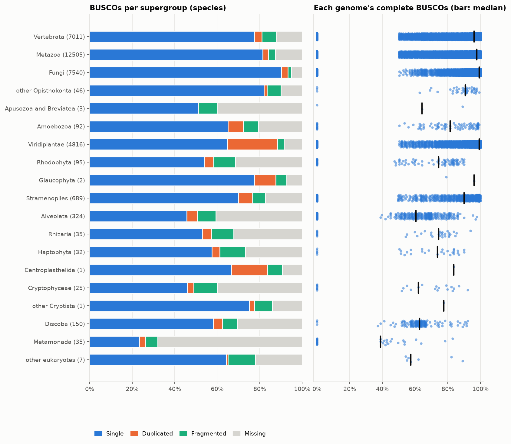

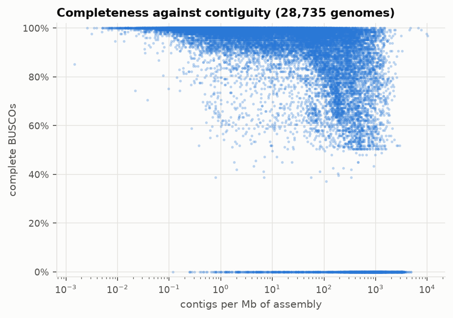

### The loci a user chooses among (`busco/loci.tsv`)

Not a benchmark table but the package's own: each BUSCO's call rate over all species and per supergroup, which a
user (protal's euk30) chooses its loci by ([loci.md](loci.md)).

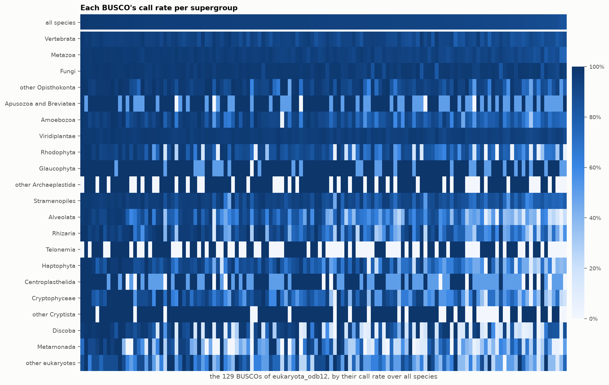

### Gene models against OrthoDB (`orthodb.tsv`)

BUSCO's dataset holds, for each BUSCO, OrthoDB's protein in each of its ~450 species: that species' annotated gene.
Where a package species is one of them, its call is compared with it. The call's coding sequence (its exons, from
`busco/features.tsv`) is translated by the species' genetic code, and the two proteins' 5-mers are compared both
ways: `recall`, the share of OrthoDB's protein found in the call, and `precision`, the share of the call found in
OrthoDB's. The right gene model of the right gene gives both near 1:
- `concordant`: both 0.9 or more;
- `similar`: both 0.5 or more (another exon end, an isoform, another assembly of the species);
- `discordant`: another gene (a paralog, or an ohnolog of a duplicated genome) or a broken model;
- `missed`: OrthoDB annotates the gene, Eukore called nothing.

The package's calls are queried with the proteins of the dataset species nearest to the genome, for these species
their own (`guided`): they find OrthoDB's own protein again, which is circular. So the process stage calls a dataset
species' genome a second time with its own proteins (its species' and strains') left out of the queries, its nearest
other dataset species' and the ancestral variants kept (`WORK/done/<accession>/held_out.tsv`, since 2026-11-06; the
package keeps its first calls). The `held_out_` columns compare these calls with OrthoDB's gene model: the measure to
quote, of a genome whose nearest dataset relative is another species. It still measures the gene structure and the
copy chosen near the dataset species, not the reach into species far from every one (completeness per supergroup
shows that). OrthoDB's gene may also be annotated on another assembly of the species.

The 5-mer verdicts weigh the exon ends as much as the gene: a call on the right gene with an exon end off by a few
codons is `similar`, one with a missed small exon may be `discordant`. So the held-out calls are also laid on the
package's own calls of the species (made with its own proteins): `held_out_place` (`same`: on that call's contig,
overlapping it; `elsewhere`) and `held_out_span` (the two spans' intersection over union), and `summary.json`'s
`orthodb.held_out.place` gives the share on the same gene and of those the share sharing 90% of the span. A held-out
call that the rescue pass made is `held_out_rescued` `t`.

The held-out calls cost one more BUSCO search for each of the ~450 dataset species' genomes (their seconds in
`done.json`'s `held_out`, not in `runtime.tsv`). A genome run before 2026-11-06 is run again by `--stage process`
where its genome is still on disk (never fetched again for it); a package measured without them says so in
`summary.json`'s `left_out`.

**The clade hold-out** (`holdout.tsv`, `summary.json`'s `orthodb.clade_hold_out`; since 2026-11-09). The species'
hold-out keeps its congeners' proteins (*S. mikatae*'s calls are queried with *S. cerevisiae*'s), so it says little of
a genome far from every dataset species, the lineages a eukaryote reference is most needed for. A dataset species'
genome is called again without every dataset species of its genus, then of its family, then of its order
(`--held_out_ranks`, default all three; a rank that leaves out no more species than the one below is not called
again), and each level's calls are set beside OrthoDB's gene models as above. Each level names the rank its lineage
shares with the nearest dataset species it kept (`nearest`): the curve of concordance against that distance is the
measure of the reach. Each level costs one more BUSCO search of each dataset species' genome; a genome run before
2026-11-09 gets its levels from the process stage's backfill where its genome is on disk.

**The annotation swap** (`tools/annotation_swap.py`; since 2026-11-09). A copy takes its genome's own annotated model
where the HMM confirms it, and the build's `annotation.tsv` lays miniprot's model on that same annotation: circular
for the copies that take it. The tool calls a genome's BUSCOs with one annotation (the swap's source) and lays
miniprot's model and the copy shipped on another, independent one (the truth): exact introns, the whole intron chain
exact, coding-base F1, and per swapped copy `better`, `same` or `worse`. On *Takifugu rubripes* (fTakRub1.2,
2026-11-09; RefSeq's annotation, NCBI's pipeline, as the truth, Ensembl's genebuild of 2019 swapped in): 119 of 128
copies took Ensembl's model, 24 better, 73 the same, 22 worse; whole chains exact 85 (miniprot) and 88 (shipped);
coding-base F1 0.990 and 0.988. The other way round (Ensembl's as the truth, RefSeq's swapped in, the build's order:
NCBI's first): 127 took RefSeq's, 28 better, 93 the same, 6 worse; chains 75 and 88, F1 0.980 and 0.982. So RefSeq's
models agree with Ensembl's more often than miniprot's do, Ensembl's 2019 models with RefSeq's about as often: the
swap helps with NCBI's annotation and is neutral with Ensembl's own genebuild. Of the 592 assemblies Ensembl annotates
by BRAKER or Helixer, two have a RefSeq annotation to be the truth (2026-11-09: the coral *Stylophora pistillata*, the
jellyfish *Rhopilema esculentum*); the rest are why Ensembl is asked. On the jellyfish (ASM1307630v1, far from BUSCO's
dataset species; Ensembl's BRAKER run of 2023 swapped in, RefSeq's as the truth) 96 of 128 copies took BRAKER's model,
57 better, 25 the same, 14 worse; whole chains exact 49 (miniprot) and 74 (shipped); F1 0.949 and 0.965. The farther a
genome is from the dataset, the more the swap is worth.

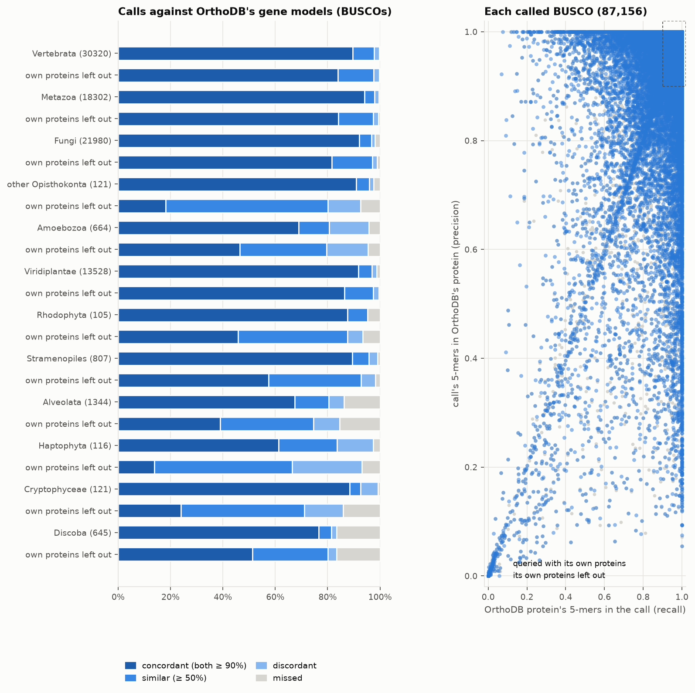

### Resolution (`resolution.tsv`)

How well a marker tells species apart, the question a read profiler asks of it. For each copy, its nearest copy of
another species (vsearch over the copies' coding sequences, the search of the `own_species` check; one 18S per
species, its best record's of 1,000 bases or more): their identity and the deepest rank the two species share
(genus .. phylum, or none). Per marker (each BUSCO, all BUSCOs, the 18S) and shared rank, the table gives the
identity's quantiles and the copies under 97% and 99%. A copy under 99% to every other species is one that a read
assignment at 99% keeps to its species.

Read it with the package's sampling in mind: a species whose genus holds no other genome can only meet a farther
relative.

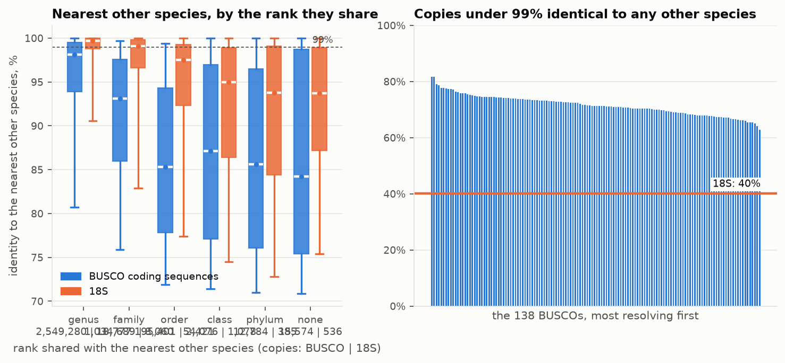

### Confidence (`completeness.tsv`, `rrna.tsv`)

The copies' and records' tiers (`high`, `unverified`, `medium`, `low`; `unverified` since format 6, 2026-11-09), the
sum of the checks that set them ([FORMAT.md](FORMAT.md#confidence-tiers-format-6)): another organism's sequence
(`own_species`, FCS-GX, tiara, a bacterium's SSU as an 18S), a duplicated or fragmented call, a length off its
relatives', a contig end, an assembly gap, a stop inside the protein; for rRNA, ambiguous bases, homopolymers, the
part screen, a partial 28S, a read labelled by its genus. A sequence its own-species check could not decide is
`unverified` (until format 6 `medium`): a species with no relative of its family in the package, and (until
2026-11-10, when their check was not made) the published reads.

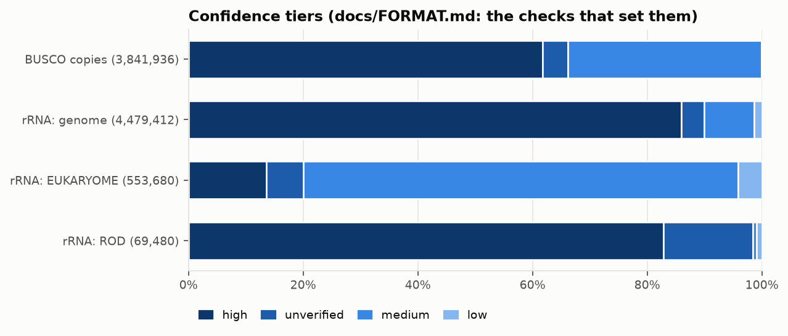

### rRNA operons (`rrna.tsv`)

Per source (the genomes, curated units, EUKARYOME, ROD) and kind (an operon, an 18S alone): the records holding each
region (18S, ITS1, 5.8S, ITS2, 28S, an inline 5S), a whole 28S, an 18S intron.

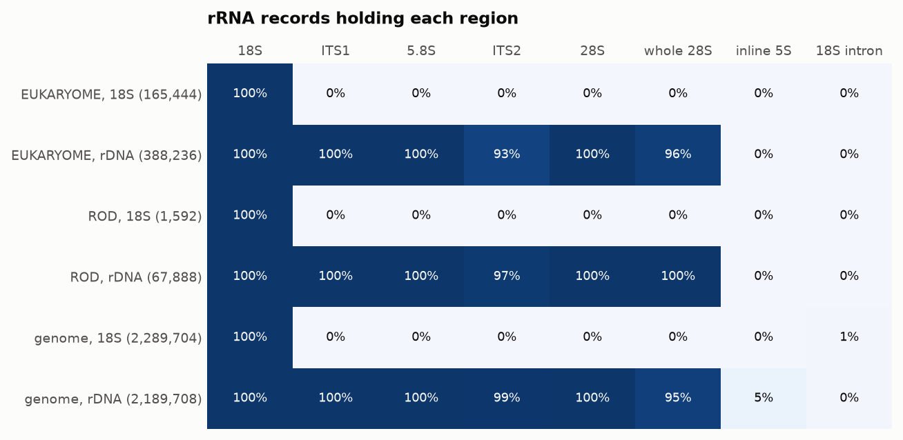

### Names in the 18S references (`labels.tsv`)

Per supergroup and reference (PR2, EUKARYOME, KSGP), the species named by their name, an NCBI synonym, their genus
alone, or not at all: how far a user can carry a package species into those references' taxonomies.

`summary.json`'s `labels` is each reference's share of all the package's species; since 2026-11-17 `labels_of_marker`
is its share of the species holding the marker it is a reference of (an rRNA record; for MIDORI2 an organelle gene).
The first falls with every species the package takes for another marker: the 2026-11-17 build's 244,135 species of
organelle genes alone made PR2 name 11.7% of its species, where it names 47.6% of the 79,581 with an rRNA record.

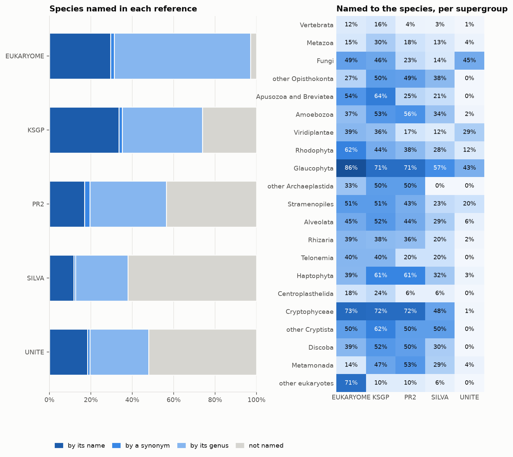

### Run time (`runtime.tsv`, `stages.tsv`)

Each genome's run (its BUSCO calls, windows, tiara, rRNA) in seconds against its size, from `WORK/done/*/done.json`
(genomes run since 2026-11-06), and the package stage's steps.

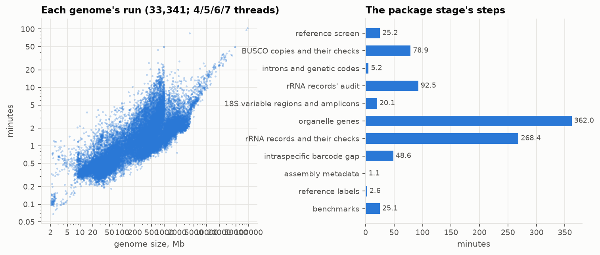

### Primer coverage (`primers.tsv`; since 2026-11-07, format 5)

Per primer pair of `data/primer_pairs.tsv` and group, the species with a record the pair runs on and those with one
it amplifies (`rrna/amplicons.tsv`, `organelle/amplicons.tsv`; the rule in [methods.md](methods.md)). `summary.json`'s
`primers`: each pair's share over all species.

Since 2026-11-17 also `with_sites`, the species whose record holds both primers' sites (each primer's best place
within a third of its length in mismatches: `primers.SITE_SHARE`), and `share_of_sites`, those amplified of them. A
published barcode is the amplicon with its primers cut off: of MIDORI2's COX1 records (GB273, 4,000 drawn) 73% hold
neither site of Folmer's pair and 16% both, so the share of all species with a record fell from 41% of the animals
(the 2026-11-14 build, whose COX1 were mitochondrial genomes' whole genes) to under 4% (the 2026-11-17 build, with
MIDORI2's) without any change in the primers. `share_of_sites` is what the primers do; `share` what the records are.

### Barcode gap (`summary.json`'s `barcode_gap`; since 2026-11-07, format 5)

From the package's `intraspecific/barcode_gap.tsv`: per marker (the BUSCOs together), the panel species measured and
the share resolved (every assembly of the species nearer to each other than to any other species).

## The figures here

The figures above are those of the build of 2026-11-17, drawn that day from its evaluation bundle (`Eukore_2026.11`:
Eukore 0.2.7, format 7; 33,460 genomes, 328,262 species; `python3 -m eukore_bench.figures PACKAGE`). That build is no
release: it was built without tiara, VEuPathDB's annotations and KSGP 5.2, and it predates the changes its evaluation
led to (a copy's first 5,000 bases compared across species, the primer pairs counted on the records that hold their
sites, a reference's names counted on the species that hold its marker). A release's own tables are in its
`benchmarks/`, and `benchmarks/eukore-figures.sh` draws its figures. Until 2026-11-17 the figures here were those of
the first full build (2026-11-14: Eukore 0.2.4, format 6; 33,664 genomes, 47,479 species), until 2026-11-15 a
seven-clade trial's (33 genomes).

What the build shows:
- **Completeness** follows BUSCO's dataset: a median of 98.4% of the 129 BUSCOs per genome (the genomes whose
  copies the package holds: its tiers genome, draft and transcriptome), 99.2% in Viridiplantae and Fungi, 98.4% in
  Metazoa and 96.9% in Vertebrata, but 91.5% in Stramenopiles, 66.7% in Alveolata, 62.8% in Discoba and 45.4% in
  Metamonada. Chromosome-level assemblies of those lineages are no more complete: the limit is the locus set and its
  query proteins (lost or far diverged genes), not the assemblies. Against the BUSCOs each clade's best genomes
  hold (`complete_expected`) the medians are 77.4%, 88.8% and 73.0%. 2,251 genomes are of tier poor, 260 partial and
  300 contaminated: their copies are left out.
- **OrthoDB**: of the 88,053 BUSCOs OrthoDB annotates in 837 of the build's species, Eukore called 98.8%, 91.9% of
  them OrthoDB's own gene model.
- **OrthoDB, own proteins left out** (the held-out calls): 99.0% called, 82.8% of them concordant, 99.6% on the same
  gene. With whole clades left out, the gene model holds while the nearest dataset species kept shares the class
  (81-87% concordant) and falls beyond it (phylum 62%, none 34%): what is lost is the exon ends, not the gene. The
  held-out figures are the ones to quote.
- **Annotation**: laid on 8,378 genomes' own annotation, 92.3% of the calls' introns are exact; coding bases' recall
  94.5%, precision 96.7%.
- **Resolution**: 62.4% of the BUSCO copies are under 99% identical to their nearest congener, against 30.6% of the
  species' 18S: among congeners the BUSCOs tell species apart where the 18S cannot. Of the other markers (measured
  since format 7): COX1 84.6%, ITS 77.6%, the 28S' D1-D2 43.4%, matK 12.1%, rbcL 6.1%.

| benchmark | figure |
|---|---|
| package | Eukore_2026.11, 33,460 species' genomes, 129 BUSCOs |
| species; with a genome; with rRNA records alone; with organelle genes alone | 328,262; 33,460; 50,667; 244,135 |
| median complete BUSCOs per genome | 98.4% (77.6% of genomes at 90% or more) |
| BUSCOs OrthoDB has a gene model of, called | 98.8% of 88,053 (837 species) |
| of those called, OrthoDB's gene model (5-mers ≥ 90% both ways) | 91.9% |
| the same, called without the species' own proteins | 99.0% called, 82.8% of them OrthoDB's gene model (837 species) |
| of those also called with its own proteins, on the same gene | 99.6% of 86,857, 89.7% of them sharing 90% of the span; 517 called by the rescue pass |
| calls laid on their genome's annotation (8,378 genomes): introns exact; coding bases' recall, precision | 92.3%; 94.5%, 96.7% |
| BUSCO copies under 99% identical to any other species | 72.1% of 3,842,912 |
| BUSCO copies under 99% identical to their nearest congener | 62.4% of 2,440,007 |
| 18S copies under 99% identical to any other species | 39.8% of 73,479 |
| 18S copies under 99% identical to their nearest congener | 30.6% of 45,999 |
| COX1 copies under 99% identical to their nearest congener | 84.6% of 171,050 |
| rRNA records; operons with a whole 28S | 5,102,572; 95.1% of 2,645,832 |
| species named in EUKARYOME by name or synonym | 18.6% of all, 73.3% of the 79,581 with an rRNA record |
| species named in KSGP by name or synonym | 17.4% of all, 71.6% of those with an rRNA record |
| species named in PR2 by name or synonym | 11.7% of all, 47.6% of those with an rRNA record |
| genome run (BUSCOs, rRNA), median | 1.1 min, 3 min per Gb of genome |

The whole table, with the clade hold-outs, the barcode gap per marker, the primer pairs and (since 2026-11-18) the
comparisons and the read benchmark: [benchmarks/figures/summary.md](benchmarks/figures/summary.md).

### The comparisons and the read benchmark on that build (2026-11-18)

The benchmark step (`eukore.sh benchmark`: [benchmarks/README.md](../benchmarks/README.md)) ran on the same package
with the build's own taxonomy, 10 other databases and 48 test genomes (16 supergroups, 3 each; about 3 h of the cluster's
time, 156 min of it the tree). Its tables and figures are those of the website's Benchmarks page. What it shows:
- **Breadth**: a genome of every genus (14,322), family (3,945), order (1,013), class (274) and phylum (73) NCBI has
  one of; 328,262 species with any record, against MIDORI2's 295,550, UNITE's and KSGP's 58,000, PR2's 39,265.
- **New to the other databases**: 15,384 species in Eukore and in none of the 10 others; 17,424 of the 27,213 species
  with a genome's 18S in none of PR2, SILVA, KSGP and EUKARYOME; ITS 15,015 of 22,901; operons 16,231 of 22,923;
  mitochondrial genes 4,706 of 10,581 (in no MIDORI2).
- **What Eukore lacks** (`missing.tsv`, 53,448 species): UNITE's 36,415 (20,065 plants', 15,929 fungi's ITS, species
  with no genome and none in EUKARYOME), MIDORI2's 14,590 (6,955 other animals', 4,010 vertebrates', 2,448 plants'),
  PR2's 841, KSGP's 771, SILVA's 650, EUKARYOME's 119 (prokaryote names among them: *Bacillus cereus*,
  *Pseudomonas fluorescens*, which Eukore leaves out by design) and EukDetect2's 62, all placeholders (*Piromyces*
  sp., "uncultured eukaryote"): every real species of EukDetect2's 6,594 is in Eukore.
- **Records beside other databases** (the same species' marker): EUKARYOME's 553,680 records, 171,756 agree with
  Eukore's genomes, 2,062 are another species' gene and none unlike; MIDORI2's 912,289, 870,050 agree and 4,412 are
  another species'; of PR2's 38,615 18S, 31,020 agree, 3,208 are another species' and 3,063 unlike (SILVA 9,341, 1,057,
  1,662 of 12,586; UNITE's ITS 4,571, 404, 1,971 of 7,571).
- **The tree**: 17,512 genomes' BUSCO proteins (50 genes): NCBI's taxa that are one branch are 82.3% of genera
  (4,253), 76.3% of families, 69.2% of orders, 72.4% of classes and 57.6% of phyla; 471 genomes sit apart from their
  taxon.
- **Reads, the species in the reference** (marker reads of the test genomes: species recall; precision): Eukore
  44.7%; 98.5% (genus 84.8%; 99.6%), its exons alone 17.7%, EukDetect2 20.9%; 91.3%. The species held out: genus
  recall 56.8%, precision 97.1% (EukDetect2 9.5%; 97.9%). The reads come from Eukore's own loci: the other references
  hold other genes (PR2, SILVA and UNITE: 18S and ITS only), so these figures say what the package holds, not that
  its references beat theirs.
- **Detection** (a sample: a test genome's reads and as many bacterial reads; a taxon with 3 reads and 1% of those
  placed), F1 at 1,000, 5,000 and 20,000 reads: the species, Eukore 0.54, 0.37, 0.25, EukDetect2 0.66, 0.54, 0.35; the
  genus with the species held out, Eukore 0.52, 0.57, 0.40, EukDetect2 0.41, 0.51, 0.51; the class with the order held
  out 0.12, 0.10, 0.11 and 0.00, 0.08, 0.16. Eukore's recall rises with depth (0.42 to 0.85) and its precision falls
  (0.77 to 0.14: 243 false taxa in 48 samples at 20,000 reads, EukDetect2's 103).
- **Bacterial and archaeal reads**: 2,031 per million placed by Eukore in a eukaryote phylum (its 18S alone 1,156; PR2
  and SILVA 44; EukDetect2, MetaPhlAn 4 and UNITE none). `background_hits.tsv` says whose: all 441 reads Eukore's rRNA
  records took (the other 11 of its 452 hit BUSCO copies) hit records the package flags `ssu_prokaryote` and `low`
  (a bacterium's or an organelle's SSU in a eukaryote's assembly: 73 records, 72 of them 61 genomes' own and one
  EUKARYOME's; 42 18S, 31 operons); a reference of the medium and high records alone would place 11 reads of 160,000
  (69 per million). The host's
  reads (human chromosome 21) are scored apart: 5.9% placed, 0.25% at the species, in the BUSCO copies' introns (the
  exons alone place 0.6%).
- **Since that run** the read benchmark leaves the records of confidence `low` out of Eukore's references and of the
  test genomes' marker reads (the package's typical use keeps the high, unverified and medium ones; `--read_low` keeps
  them), so the reads and detection figures above are those of the references with every record.
- **Test genomes**: three of the 48 (a contaminated assembly of 157 Mb, a metagenome-derived one and a poor one) have
  no BUSCO copy in the package and give no marker reads; the benchmark now chooses tiers genome and draft only
  (`bench_downloads --only tests` chooses them again).

<p align="center">
  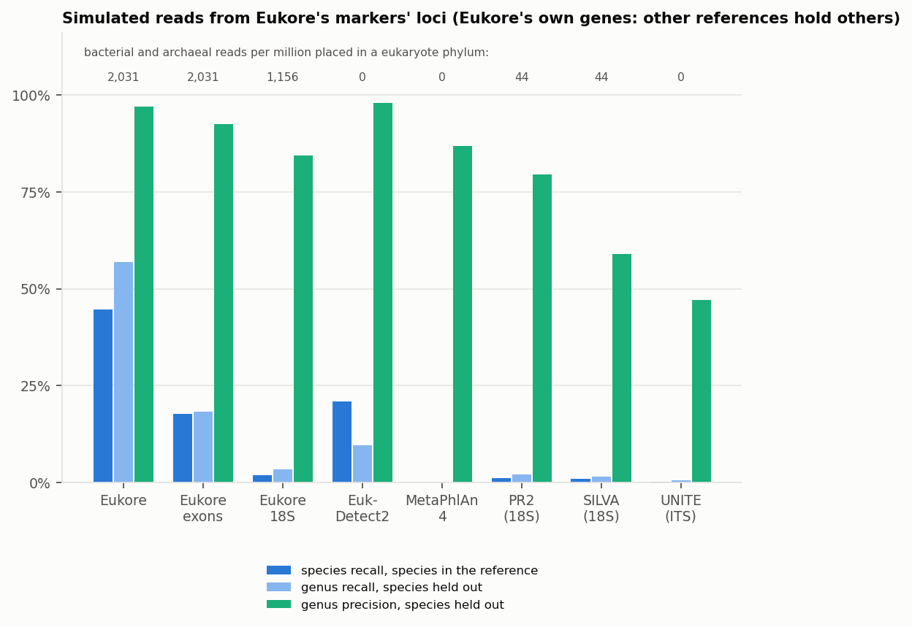<br>
  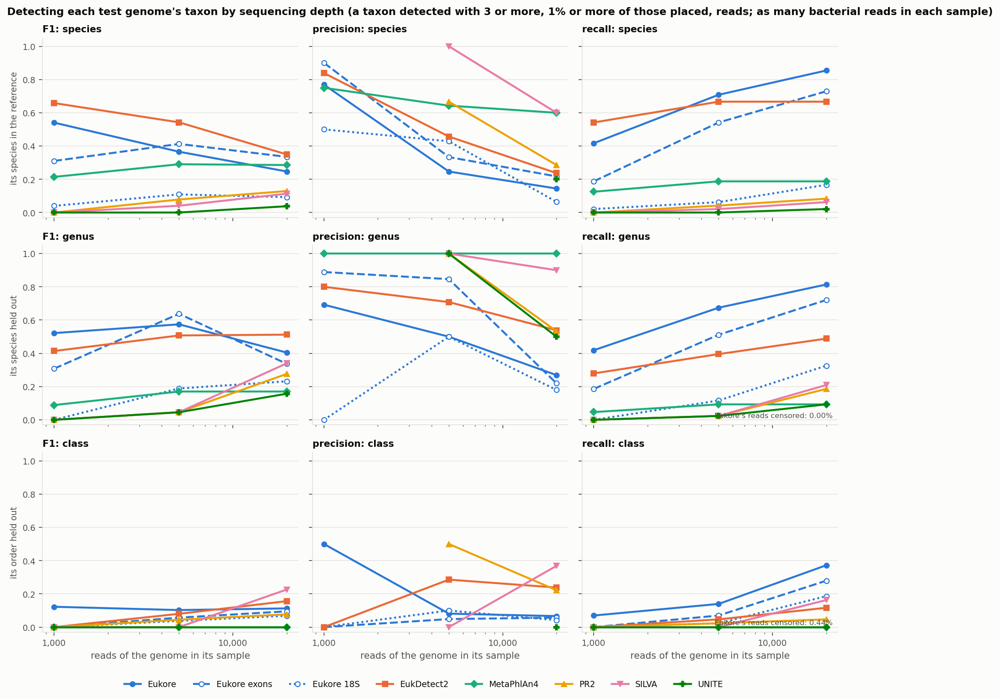<br>
  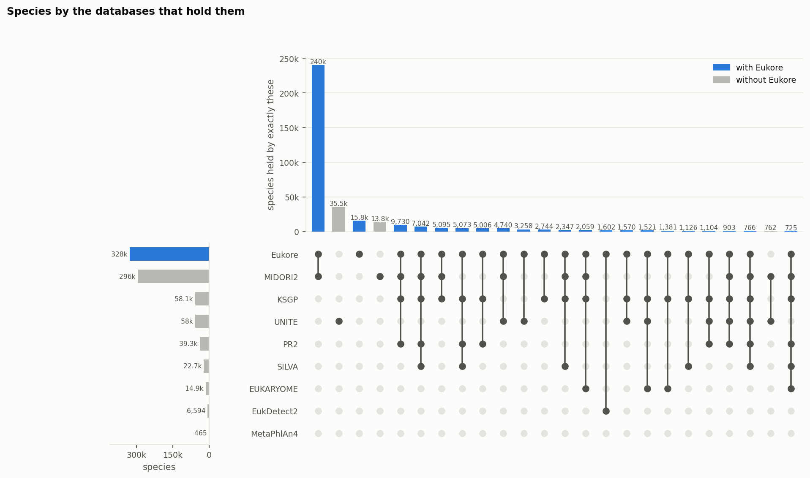<br>
  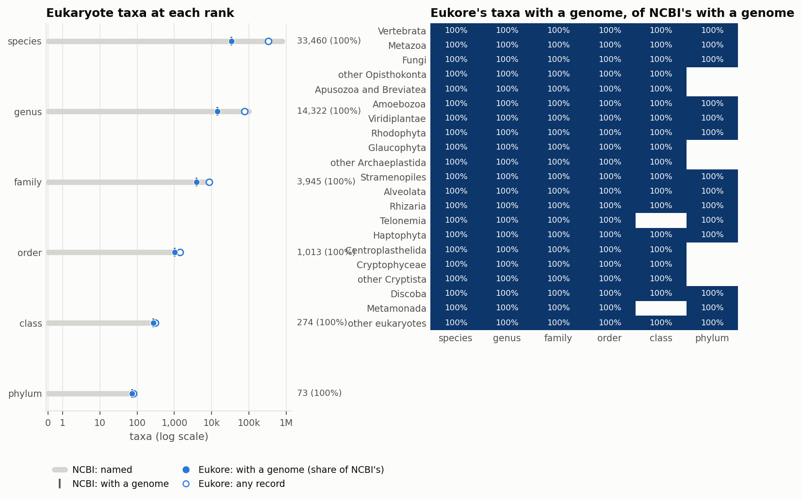
</p>

The figures are the cluster's, the rest of them in the evaluation bundle `Eukore_2026.11_benchmarks_evaluation.tar.gz`.

## The methods review's changes against the code before them (2026-11-09)

The 7-clade trial built twice from the same genomes and sources: by the code before the methods review (1e8a782) and
by 0.2.3 with the four additions above (the marker scope fixed, the clade hold-out, the harder read benchmark), one
after the other on 6 threads (`--intraspecific 2`, `--read_genomes 10`).

| | before | after |
|---|---|---|
| process stage, wall | 21.5 min | 23.9 min (+11%: the clade hold-out's calls, 270 s, and its species' hold-out 37 s more) |
| genome runs (calls, rRNA), summed | 3,429 s | 3,562 s (+4%; per genome median ×1.04) |
| a genome's BUSCO calls alone, idle machine (6 genomes, 6 threads) | | the same within run-to-run noise (±7%), but +11% CPU in *Blastocystis* sp. RusS, whose 22 copies of 100 were recovered |
| package stage, wall; CPU | 9.9 min; 2,118 s | 12.0 min; 2,683 s (rRNA checks +111 s: the 18S's SSU models; BUSCO checks +25 s) |
| peak memory | 13.5 GB | 13.6 GB |
| BUSCO copies Single, Duplicated, Fragmented | 2,973, 314, 605 | 2,975, 314, 603 (two fragments recovered whole) |
| copies with a stop inside the protein | 203 | 34 |
| tiers high, unverified, medium, low | 1,994, -, 1,865, 33 | 2,050, 568, 1,241, 33 |
| OrthoDB, own proteins: called, concordant | 96.6%, 84.5% | 96.6%, 84.5% |
| OrthoDB, held out: called, concordant | 94.7%, 75.3% | 94.7%, 75.0% (228 of 321 against 229) |
| copies under 99% to any other species | 65.9% | 65.7% |
| marker calls (285): identical, another exon end, another gene | | 206, 72, 2 (*Blastocystis* ST6's HSP90 and GAPDH; the HSP90 now the right gene) |
| reads, `in`: species recall, precision | 0.577, 0.990 | 0.577, 0.989 |
| detection, `in`, F1 at 1,000 / 5,000 / 20,000 reads (3 seeds' mean) | 0.80 / 0.77 / 0.67 | 0.80 / 0.75 / 0.66 (seed to seed: up to 0.07) |

New figures (the after side alone): the clade hold-out keeps every call on the right gene (100%), its concordance
from the species' level to the family's 95% to 77% in *S. paradoxus*, 95% to 83% in *S. mikatae*; with the order left
out (`novel`) 0.9% of a test's marker reads are still placed, below its class and wrong, and 1 and 7 wrong taxa
detected at 5,000 and 20,000 reads; human chromosome 21's reads (17,185) are placed nowhere; one EUKARYOME "18S"
(28 kb, filed as *Blastocystis*: likely its mitochondrion-related organelle's genome, by its bacterial-type SSU) is
`ssu_prokaryote`. No copy changed its choice by lineage nor was called cross-shared: the trial holds no contaminated
genome, so those two are tested by their unit tests alone.

## Earlier: against EukDetect2 (2026-11-05)

Before the benchmarks, the first trial (the same seven clades, 30 BUSCOs) was compared with EukDetect2's database:
- 42 species against EukDetect2's 19, 1,150 loci against its 491. The genome stage took 8.6 minutes, the published
  rRNA 21, on 6 threads.
- Of the 19 species both hold, Eukore called 473 of EukDetect2's 491 loci, and 50 more.
- Where the genome is the same (the yeasts, *C. albicans*), its copies hold all of EukDetect2's copy's 21-mers, at
  the same length.
- The model species got 29-30 loci each.

## The paper's data (since 2026-11-06)

The build also collects what the paper's figures need of the package alone (benchmarks/'s `eukore-figures.sh`
draws them, with `index.md` captioning each and naming its tables):
- **The genome set** (`selection.tsv`, `selection_taxa.tsv`, `breadth.tsv`): what became of every NCBI taxon with an
  assembly (counted per supergroup, and since 2026-11-12 taxon by taxon), and the species per supergroup in NCBI and
  Eukore (another reference's columns: benchmarks/'s comparisons; the breadth above the species: benchmarks/'s
  `breadth_ranks.tsv`).
- **Gene models against the genome's own annotation** (`annotation.tsv`, `genes.tsv`): a truth set independent of
  BUSCO's dataset. The fetch stage takes each genome's annotation (NCBI's GFF, RefSeq's or a submitter's, not asked
  for where the assembly summary gives no protein-coding genes; else Ensembl's, else TOGA2's: `source`) and NCBI's
  assembly report
  beside the genome; the process stage lays each call's miniprot model on it (`eukore/annotation.py`): the transcript
  sharing most coding bases, the exons and splice sites exact, the coding bases shared; then deletes them. (The copy
  itself takes the annotation's model where its HMM confirms it, `model` its source; the table measures miniprot's.) `genes.tsv` gives each genome's distance to BUSCO's dataset
  (the x of Figure 1b) and its copies' intron bases (what an exon-only reference leaves out).
- **Reads** (`reads.tsv`, `detection.tsv`, `background_hits.tsv`): the read benchmark, since 2026-11-12 benchmarks/'s
  (`eukore-benchmark.sh`; [benchmarks/README.md](../benchmarks/README.md#the-read-benchmark)). The bacterial and
  archaeal background's reads, wrong wherever placed, are counted apart from the host's (human chromosome 21, right on
  its own lineage); `background_hits.tsv` names the records that attract them.
- **The checks** (`flags.tsv`), **rRNA regions' and mitochondrial genes' lengths** (`rrna_regions.tsv`),
  **organelle coverage** (`organelle.tsv`), **rRNA copies per genome as assembled** (`rrna_copies.tsv`).
- **Other databases** (`overlap.tsv`): the species of PR2, EUKARYOME's long reads, KSGP, ROD, BUSCO's OrthoDB
  dataset, against Eukore's, per supergroup; the other references' rows are benchmarks/'s comparisons.

```bash
bash benchmarks/eukore-figures.sh BENCH OUT/Eukore_2026.11 RESULTS --format pdf   # Figure 1 and the others
```

## Not measured yet

- **Read assignment.** Reads simulated from held-out genomes, profiled against the package by a read profiler
  (protal): the end-to-end measure, which needs a profiler and so is not part of Eukore's build.
- **Divergent genomes.** OrthoDB's gene models exist only for the dataset's species; how far from them a call stays
  right is seen in the clade hold-out (since 2026-11-09: the dataset species' genomes without their genus', family's
  and order's), not on a genome of a lineage the dataset holds no species of at all.
- **The organelle genes.** They have no checks across species yet, and so no benchmark.
