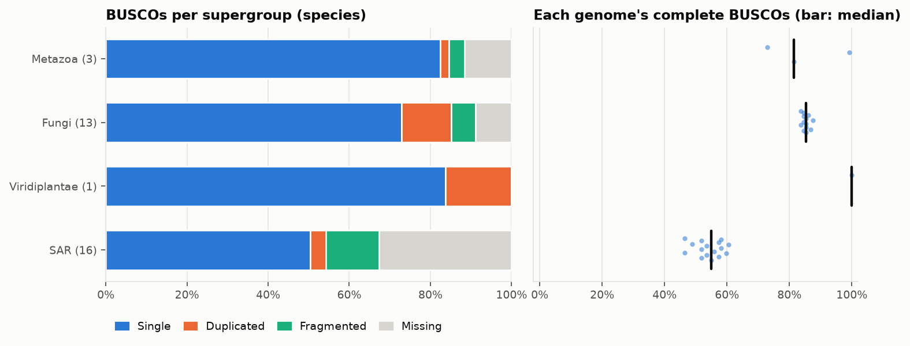
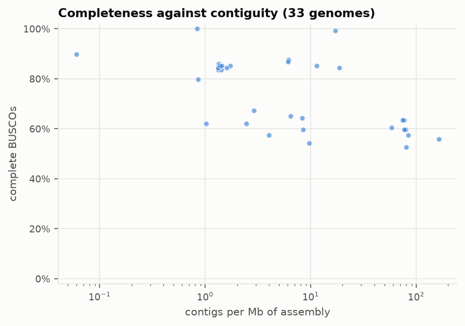
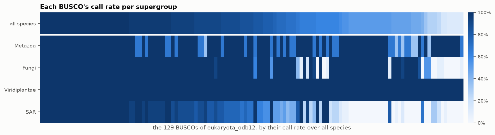
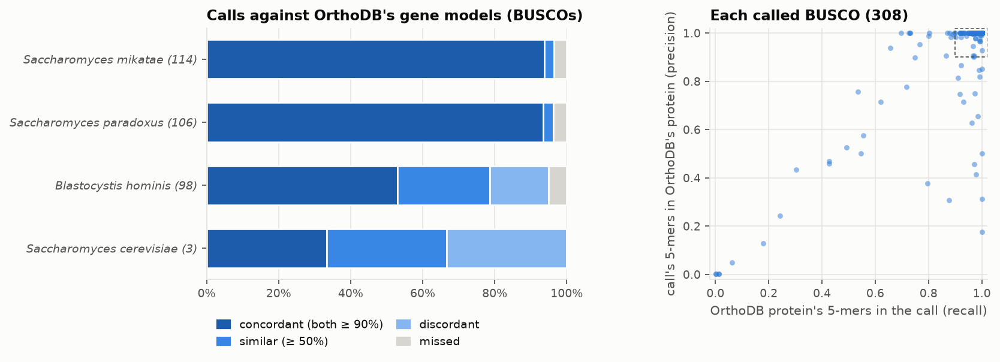
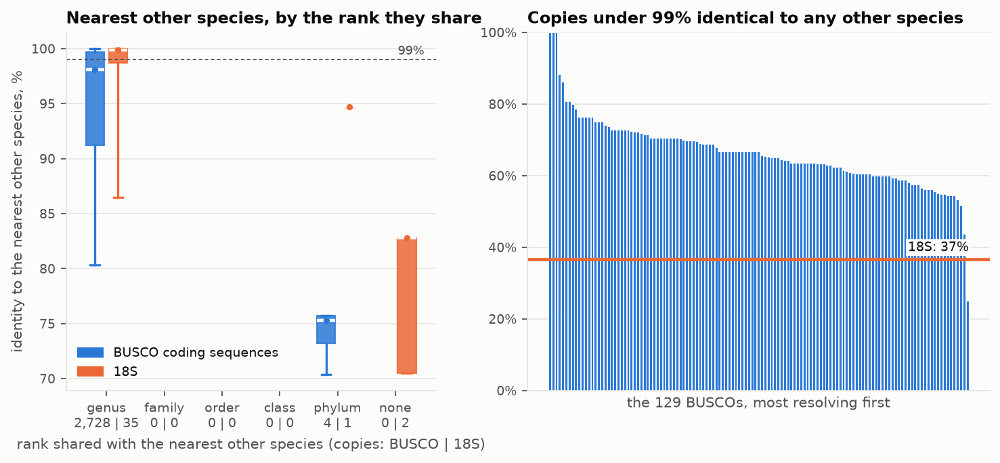
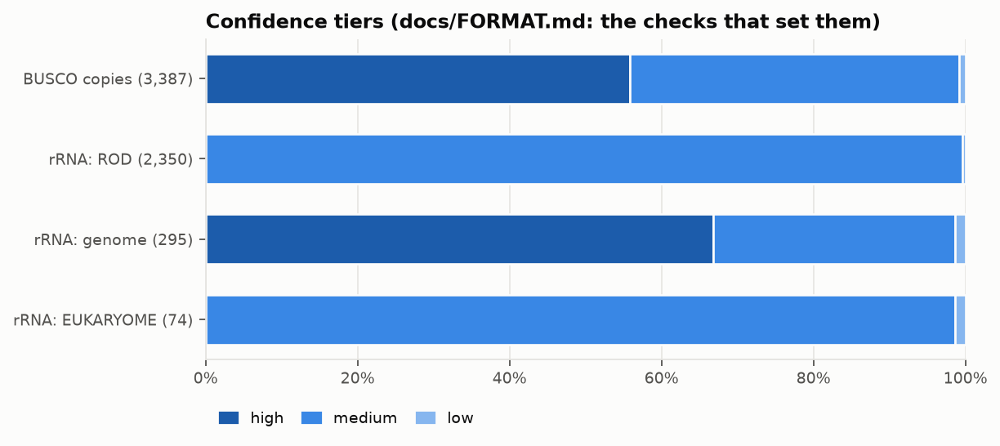
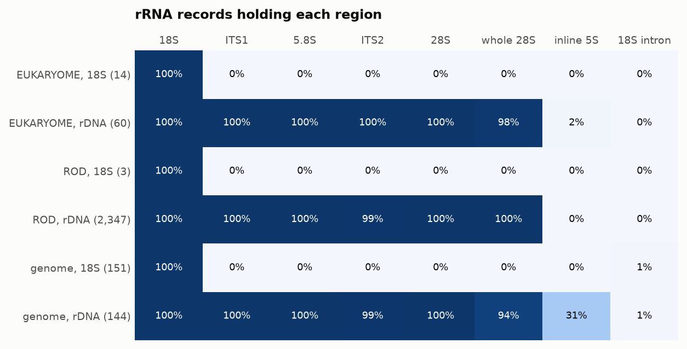
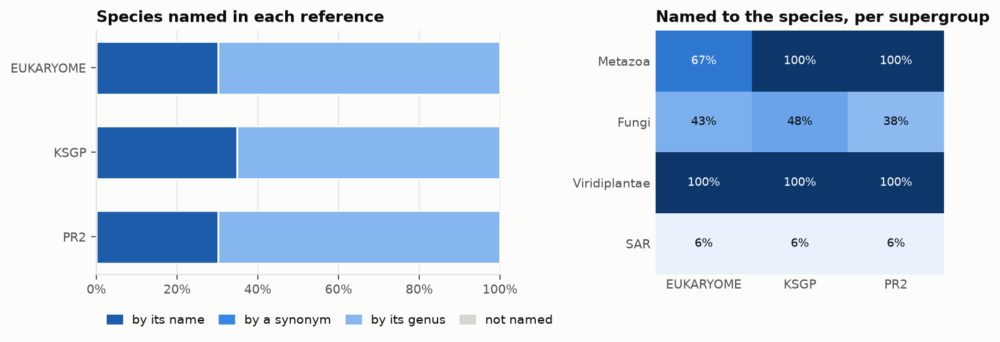
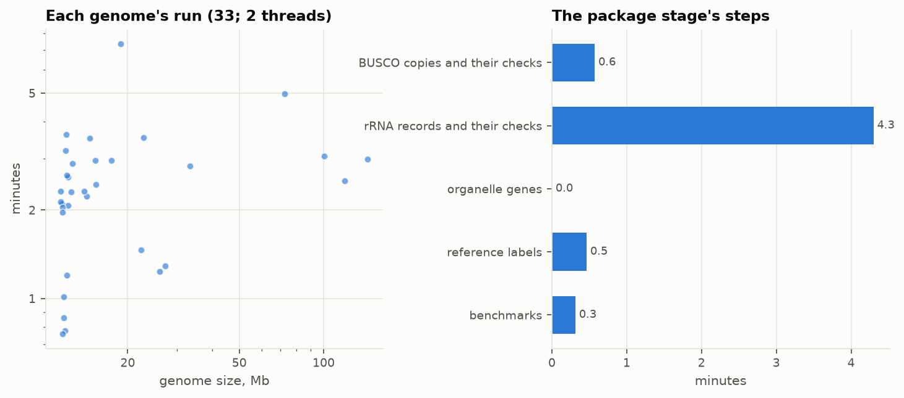

# Benchmarks

Every Eukore build measures the package it writes: how complete its genomes are, whether its gene calls are the right
genes, how well its markers tell species apart, how whole its rRNA operons are, how its species are named in the 18S
references, and what the build cost. The tables go into the package (`Eukore_<version>/benchmarks/`,
[FORMAT.md](FORMAT.md)) and its headline figures into `manifest.json`, so a release carries its own report.
`docs/benchmarks/plot_benchmarks.py` draws them.

## Running them

During a build, nothing to do: the package stage measures the package once its tables are written, before its
manifest (`--no_benchmarks` skips them). A benchmark whose inputs are missing is left out, and
`benchmarks/summary.json`'s `left_out` says why; a failing benchmark never stops the package.

Any package can be measured again afterwards, and the figures drawn:

```bash
python3 -m eukore.benchmarks OUT/Eukore_2026.11 --work WORK -t 8      # into OUT/Eukore_2026.11/benchmarks/
python3 docs/benchmarks/plot_benchmarks.py OUT/Eukore_2026.11         # into docs/benchmarks/figures/
```

`--work` gives BUSCO's dataset (`WORK/sources/eukaryota_odb12`, for the OrthoDB benchmark), NCBI's whole taxonomy
(`WORK/sources/taxdump.tar.gz`, else the package's own `taxonomy/`) and the genomes' run times (`WORK/done/`); each
can also be given alone (`--odb`, `--taxdump`). `--out` writes the tables elsewhere (a measured-again package's
manifest does not list them). The plots need matplotlib (in `envs/eukore.yaml`); `--format svg` or `pdf` for print.

## What is measured

### Completeness (`completeness.tsv`)

BUSCO's own measure, on Eukore's calls: per species' genome, its BUSCOs of eukaryota_odb12 that are Single,
Duplicated, Fragmented or Missing, and `complete`, the Single and Duplicated over all BUSCOs searched (Missing
included; a species without an assembly, of EukDetect2's records alone, left out). It is read per
supergroup: BUSCO's dataset is mostly animals, fungi and plants, and a caller that reaches only those would show it
here. Each genome's copies' confidence tiers, assembly level and contigs are beside it, so that a poor genome is told
from a poor call.





### The loci a user chooses among (`busco/loci.tsv`)

Not a benchmark table but the package's own: each BUSCO's call rate over all species and per supergroup, which a
user (protal's euk30) chooses its loci by ([loci.md](loci.md)).



### Gene models against OrthoDB (`orthodb.tsv`)

BUSCO's dataset holds, for each BUSCO, OrthoDB's protein in each of its ~450 species: that species' annotated gene.
Where a package species is one of them, its call is compared with it. The call's coding sequence (its exons, from
`busco/features.tsv`) is translated by the species' genetic code, and the two proteins' 5-mers are compared both
ways: `recall`, the share of OrthoDB's protein found in the call, and `precision`, the share of the call found in
OrthoDB's. The right gene model of the right gene gives both near 1:
- `concordant`: both 0.9 or more;
- `similar`: both 0.5 or more (another exon end, an isoform, another assembly of the species);
- `discordant`: another gene (a paralog, or an ohnolog of a duplicated genome) or a broken model;
- `missed`: OrthoDB annotates the gene, Eukore called nothing.

The package's calls are queried with the proteins of the dataset species nearest to the genome, for these species
their own (`guided`): they find OrthoDB's own protein again, which is circular. So the process stage calls a dataset
species' genome a second time with its own proteins (its species' and strains') left out of the queries, its nearest
other dataset species' and the ancestral variants kept (`WORK/done/<accession>/held_out.tsv`, since 2026-11-06; the
package keeps its first calls). The `held_out_` columns compare these calls with OrthoDB's gene model: the measure to
quote, of a genome whose nearest dataset relative is another species. It still measures the gene structure and the
copy chosen near the dataset species, not the reach into species far from every one (completeness per supergroup
shows that). OrthoDB's gene may also be annotated on another assembly of the species.

The 5-mer verdicts weigh the exon ends as much as the gene: a call on the right gene with an exon end off by a few
codons is `similar`, one with a missed small exon may be `discordant`. So the held-out calls are also laid on the
package's own calls of the species (made with its own proteins): `held_out_place` (`same`: on that call's contig,
overlapping it; `elsewhere`) and `held_out_span` (the two spans' intersection over union), and `summary.json`'s
`orthodb.held_out.place` gives the share on the same gene and of those the share sharing 90% of the span. A held-out
call that the rescue pass made is `held_out_rescued` `t`.

The held-out calls cost one more BUSCO search for each of the ~450 dataset species' genomes (their seconds in
`done.json`'s `held_out`, not in `runtime.tsv`). A genome run before 2026-11-06 is run again by `--stage process`
where its genome is still on disk (never fetched again for it); a package measured without them says so in
`summary.json`'s `left_out`.



### Resolution (`resolution.tsv`)

How well a marker tells species apart, the question a read profiler asks of it. For each copy, its nearest copy of
another species (vsearch over the copies' coding sequences, the search of the `own_species` check; one 18S per
species, its best record's of 1,000 bases or more): their identity and the deepest rank the two species share
(genus .. phylum, or none). Per marker (each BUSCO, all BUSCOs, the 18S) and shared rank, the table gives the
identity's quantiles and the copies under 97% and 99%. A copy under 99% to every other species is one that a read
assignment at 99% keeps to its species.

Read it with the package's sampling in mind: a species whose genus holds no other genome can only meet a farther
relative.



### Confidence (`completeness.tsv`, `rrna.tsv`)

The copies' and records' tiers (`high`, `unverified`, `medium`, `low`; `unverified` since format 6, 2026-11-09), the
sum of the checks that set them ([FORMAT.md](FORMAT.md#confidence-tiers-format-6)): another organism's sequence
(`own_species`, FCS-GX, tiara, a bacterium's SSU as an 18S), a duplicated or fragmented call, a length off its
relatives', a contig end, an assembly gap, a stop inside the protein; for rRNA, ambiguous bases, homopolymers, the
part screen, a partial 28S, a read labelled by its genus. A sequence its own-species check could not decide is
`unverified` (until format 6 `medium`): published reads mostly, whose own-species check is not made, and a trial's
species with no relative of their family in it. The figure below is of a format-5 trial: its `medium` holds what
format 6 calls `unverified`.



### rRNA operons (`rrna.tsv`)

Per source (the genomes, curated units, EUKARYOME, ROD) and kind (an operon, an 18S alone): the records holding each
region (18S, ITS1, 5.8S, ITS2, 28S, an inline 5S), a whole 28S, an 18S intron.



### Names in the 18S references (`labels.tsv`)

Per supergroup and reference (PR2, EUKARYOME, KSGP), the species named by their name, an NCBI synonym, their genus
alone, or not at all: how far a user can carry a package species into those references' taxonomies.



### Run time (`runtime.tsv`, `stages.tsv`)

Each genome's run (its BUSCO calls, windows, tiara, rRNA) in seconds against its size, from `WORK/done/*/done.json`
(genomes run since 2026-11-06), and the package stage's steps.



### Primer coverage (`primers.tsv`; since 2026-11-07, format 5)

Per primer pair of `data/primer_pairs.tsv` and group, the species with a record the pair runs on and those with one
it amplifies (`rrna/amplicons.tsv`, `organelle/amplicons.tsv`; the rule in [methods.md](methods.md)). `summary.json`'s
`primers`: each pair's share over all species.

### Barcode gap (`summary.json`'s `barcode_gap`; since 2026-11-07, format 5)

From the package's `intraspecific/barcode_gap.tsv`: per marker (the BUSCOs together), the panel species measured and
the share resolved (every assembly of the species nearer to each other than to any other species).

## The figures here

The figures above are those of a trial build, not of Eukore: the seven clades of the 2026-11-05 trial (*Saccharomyces*,
*Candida albicans*, *Blastocystis*, *Drosophila melanogaster*, *C. elegans*, *Arabidopsis*, *Trichuris trichiura*;
33 genomes, 1 Gb), all 129 BUSCOs, built again on 2026-11-06 with the rescue pass (`Eukore_2026.11-rescue`; the
published rRNA reads annotated in an earlier run). Its genomes ran while other jobs loaded the machine, so the run
time (`runtime.png`, the table's last row) is that of the same trial built before the rescue pass, on 6 threads (26
minutes for the genomes, 6 for the package stage). The rescue pass itself, measured alone on *Drosophila*'s 144 Mb
genome (one BUSCO missed): 8 seconds for its six-frame ORFs, 2.5 seconds per missed BUSCO's HMM search. They show
what the benchmarks look like; a release's own are in its `benchmarks/` (`python3 docs/benchmarks/plot_benchmarks.py`
redraws these).

What the trial shows:
- **Completeness** follows BUSCO's dataset: the plant 100%, the fungi 85%, the animals 90%, *Blastocystis* (SAR, 16
  genomes) 60%. The rescue pass added 289 copies (Single or Duplicated: 3,002 to 3,149), 11-30 in each *Blastocystis*,
  13 and 14 in *C. elegans* and *Trichuris*, none in the yeasts, *Drosophila* or *Arabidopsis*; before it, the
  animals were at 81% and *Blastocystis* at 54%.
- **OrthoDB**: of the 321 BUSCOs OrthoDB annotates in four of the trial's species, Eukore called 96%, 84% of them
  OrthoDB's own gene model; in *S. mikatae* and *S. paradoxus* 93-94%. *Blastocystis hominis*' calls are more often
  `similar` (25 of 98) or `discordant` (16): where OrthoDB's gene model is of another assembly or isolate, such
  differences are expected, and these are the calls to look at first. BUSCO's dataset holds only 3 *S. cerevisiae*
  proteins; one (10249111at2759, 84 residues in OrthoDB, 386 in Eukore's call) shares nothing with the call.
- **OrthoDB, own proteins left out** (the held-out calls): the yeasts hardly change (*S. mikatae* 105 concordant of
  114, *S. paradoxus* 97 of 106: another *Saccharomyces* is in the dataset), but *Blastocystis hominis*, with no
  close relative in BUSCO's dataset, falls from 52 concordant and 3 missed of 98 to 22 and 12 (32 missed before the
  rescue pass, which made 20 of its held-out calls). Yet each of its 86 BUSCOs called both ways is on the same gene,
  and over the four species 91% of the held-out calls share 90% or more of the span of the call made with the
  species' own proteins: what the held-out calls lose is the exon ends (`similar` 38, `discordant` 26), not the gene.
  The held-out figures (94% called, 75% of them concordant) are the ones to quote.
- **Resolution**: 65% of the BUSCO copies are under 99% identical to every other species, against 37% of the species'
  18S: among congeners the BUSCOs tell species apart where the 18S cannot.

| benchmark | figure |
|---|---|
| package | Eukore_2026.11-rescue (a trial: 7 clades), 33 species' genomes, 129 BUSCOs |
| median complete BUSCOs per genome | 79.8% (6.1% of genomes at 90% or more) |
| BUSCOs OrthoDB has a gene model of, called | 96.6% of 321 (4 species) |
| of those called, OrthoDB's gene model (5-mers ≥ 90% both ways) | 83.5% |
| the same, called without the species' own proteins | 93.8% called, 74.8% of them OrthoDB's gene model (4 species) |
| of those also called with its own proteins, on the same gene | 100.0% of 301, 91.4% of them sharing 90% of the span; 20 called by the rescue pass |
| BUSCO copies under 99% identical to any other species | 65.6% of 3,676 |
| 18S copies under 99% identical to any other species | 36.6% of 41 |
| rRNA records; operons with a whole 28S | 2,719; 99.6% of 2,551 |
| species named in EUKARYOME by name or synonym | 30.2% |
| species named in KSGP by name or synonym | 34.9% |
| species named in PR2 by name or synonym | 30.2% |
| genome run (BUSCOs, rRNA, tiara; before the rescue pass), median | 2.3 min on 2 threads, 93 min per Gb of genome |

## Earlier: against EukDetect2 (2026-11-05)

Before the benchmarks, the first trial (the same seven clades, 30 BUSCOs) was compared with EukDetect2's database:
- 42 species against EukDetect2's 19, 1,150 loci against its 491. The genome stage took 8.6 minutes, the published
  rRNA 21, on 6 threads.
- Of the 19 species both hold, Eukore called 473 of EukDetect2's 491 loci, and 50 more.
- Where the genome is the same (the yeasts, *C. albicans*), its copies hold all of EukDetect2's copy's 21-mers, at
  the same length.
- The model species got 29-30 loci each.

## The paper's data (since 2026-11-06)

The build also collects what the paper's figures need (`docs/paper/plot_paper.py` draws them; `docs/paper/figures/`
holds a trial's, with `index.md` captioning each and naming its tables):
- **The genome set** (`selection.tsv`, `breadth.tsv`): what became of every NCBI taxon with an assembly, and the species
  per supergroup in NCBI, Eukore and another reference (`--read_compare`, EukDetect2's database).
- **Gene models against the genome's own annotation** (`annotation.tsv`, `genes.tsv`): a truth set independent of
  BUSCO's dataset. The fetch stage takes each genome's annotation (NCBI's GFF, RefSeq's or a submitter's, not asked
  for where the assembly summary gives no protein-coding genes; else Ensembl's, else TOGA2's: `source`) and NCBI's
  assembly report
  beside the genome; the process stage lays each call's miniprot model on it (`eukore/annotation.py`): the transcript
  sharing most coding bases, the exons and splice sites exact, the coding bases shared; then deletes them. (The copy
  itself takes the annotation's model where its HMM confirms it, `model` its source; the table measures miniprot's.) `genes.tsv` gives each genome's distance to BUSCO's dataset
  (the x of Figure 1b) and its copies' intron bases (what an exon-only reference leaves out).
- **Reads** (`reads.tsv`, `eukore/reads.py`): up to `--read_genomes` genomes per supergroup (those with the most
  congeners first), kept through the prune. Reads simulated from their markers' loci (introns and all) and from
  anywhere in them, and from 7 bacteria and an archaeon (`data/read_background.tsv`), aligned by minimap2 to Eukore,
  Eukore's exons alone, Eukore's 18S alone and each compared reference (`--read_compare`: EukDetect2's
  database, MetaPhlAn 4's eukaryote markers and PR2's 18S, the latter two made by `tools/compare_references.py`);
  each read's hits within 1 point of its best
  (90% identical at least, 80% of the read) name their lowest common ancestor, with its own species in the reference
  and held out. No profiler is involved: the benchmark measures the reference. Detection (`detection.tsv`): each
  test genome is a sample of its reads from anywhere in it (1,000, 5,000 and 20,000) with as many bacterial reads;
  a taxon with 3 reads or more, and 1% or more of the reads placed at its rank, is detected. Per reference: F1 of detecting the right species (it in the reference)
  and genus (held out), and the samples missed, split into taxa the reference does not hold and those it holds but
  placed too few reads to.
- **The checks** (`flags.tsv`), **rRNA regions' and mitochondrial genes' lengths** (`rrna_regions.tsv`),
  **organelle coverage** (`organelle.tsv`), **rRNA copies per genome as assembled** (`rrna_copies.tsv`).
- **Other databases** (`overlap.tsv`): the species of PR2, EUKARYOME's long reads, KSGP, ROD, BUSCO's OrthoDB
  dataset and the `--read_compare` references, against Eukore's, per supergroup.

```bash
python3 docs/paper/plot_paper.py OUT/Eukore_2026.11          # Figure 1 and the supplementary figures
```

## Not measured yet

- **Read assignment.** Reads simulated from held-out genomes, profiled against the package by a read profiler
  (protal): the end-to-end measure, which needs a profiler and so is not part of Eukore's build.
- **Divergent genomes.** OrthoDB's gene models exist only for the dataset's species; how far from them a call stays
  right is seen indirectly, in completeness per supergroup.
- **The organelle genes.** They have no checks across species yet, and so no benchmark.
